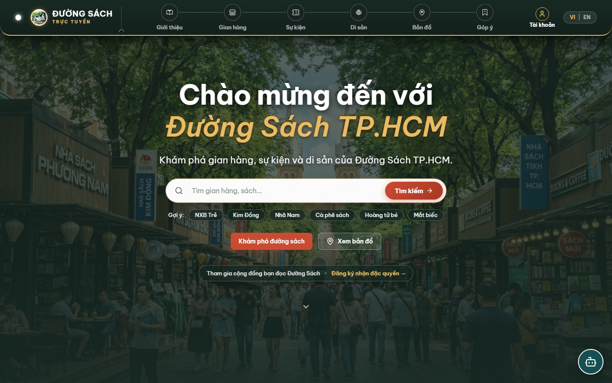
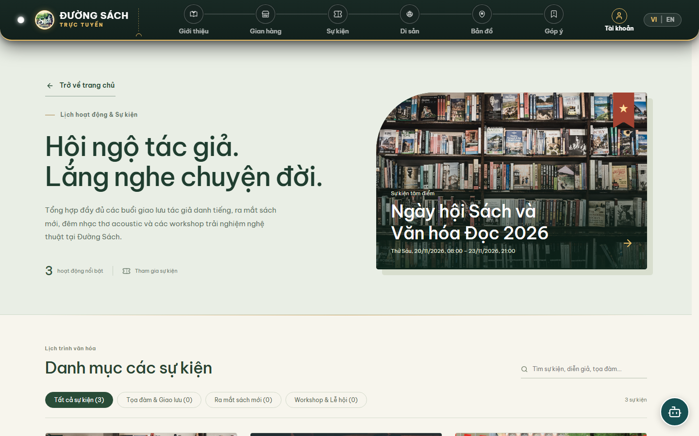
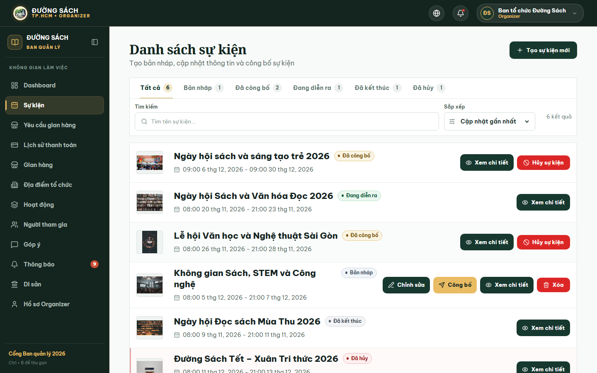
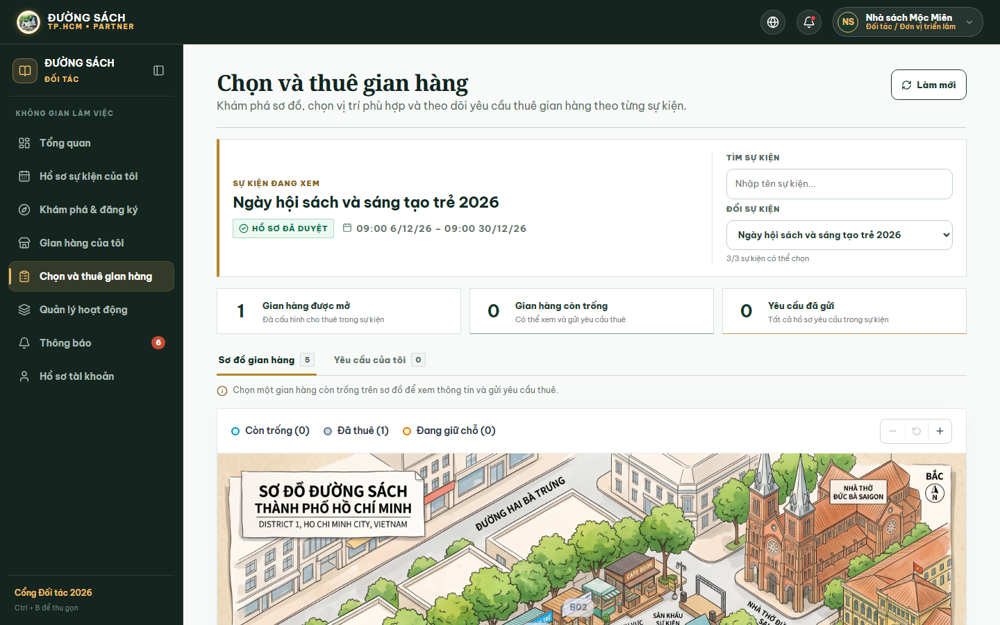
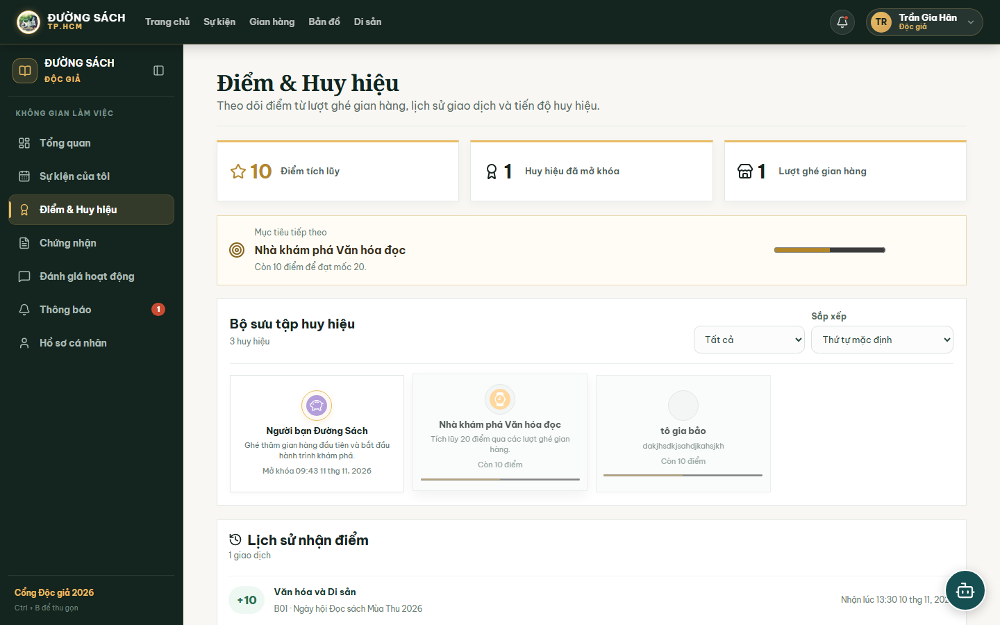
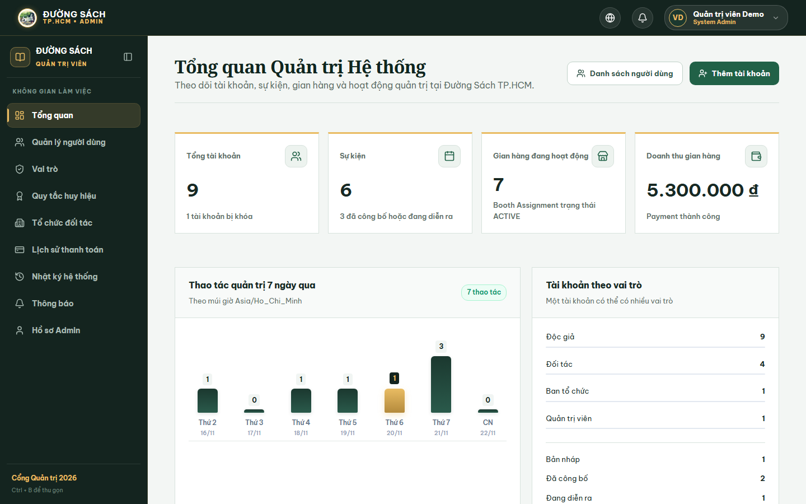
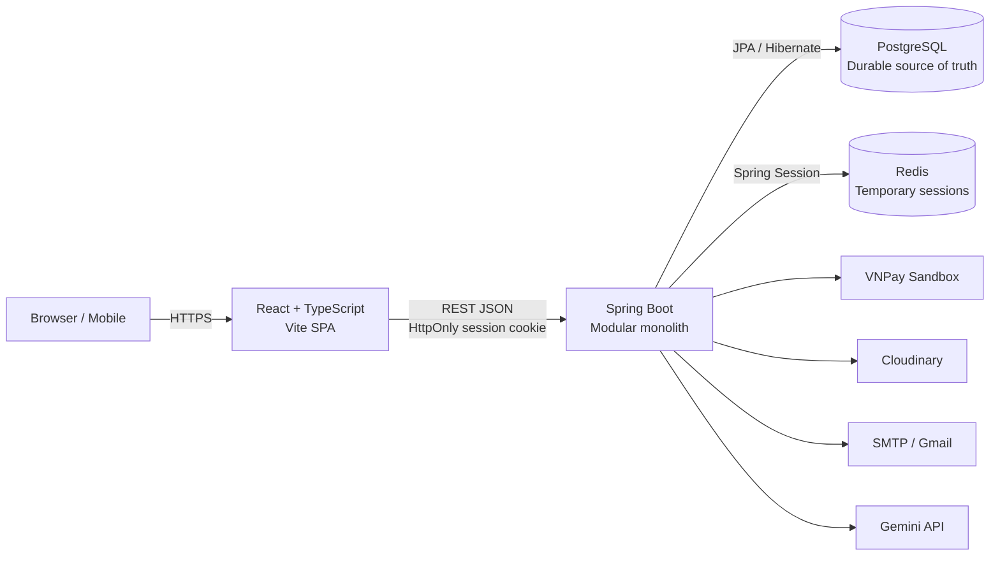

<div align="center">
  

  # BookStreet Event Management System

  **An end-to-end platform for operating book street events, partner booths, activities, participant engagement, and system administration.**

  [](https://github.com/YingKai0621/swp391-bookstreet-event-management/actions/workflows/ci.yml)
  
  
  
  
  

  [Live demo](https://bookstreet-event-management.vercel.app) · [Documentation](docs/README.MD) · [API contract](docs/api/sprint-11-api-contract.md) · [Physical ERD](docs/design/12_Physical_ERD_Report.md)
</div>

## Overview

BookStreet is a role-based event management platform designed around the operating workflow of a public book street. It connects visitors, participants, partner organizations, event organizers, and system administrators in one system instead of handling applications, booths, payments, activities, attendance, and reporting through disconnected tools.

The project is implemented as a **business-oriented modular monolith**: one Spring Boot application divided into focused business modules, backed by PostgreSQL for durable data and Redis for temporary server-side sessions. The frontend provides separate workspaces for each role while sharing one REST API and a consistent security model.

This repository is an academic software project developed for the SWP391 course at FPT University. The current codebase represents the completed MVP used for the final project demonstration.

## Product showcase

<table>
  <tr>
    <td width="50%">
      
      <br /><sub><b>Public experience</b> — discover events, booths, heritage stories, maps, and feedback channels.</sub>
    </td>
    <td width="50%">
      
      <br /><sub><b>Event discovery</b> — browse published and ongoing programs with real schedules and activities.</sub>
    </td>
  </tr>
  <tr>
    <td width="50%">
      
      <br /><sub><b>Organizer workspace</b> — manage event lifecycles, booths, activities, participants, and operations.</sub>
    </td>
    <td width="50%">
      
      <br /><sub><b>Partner workspace</b> — explore the interactive map, request booths, pay, and propose activities.</sub>
    </td>
  </tr>
  <tr>
    <td width="50%">
      
      <br /><sub><b>Participant rewards</b> — earn points and badges from verified booth visits and event participation.</sub>
    </td>
    <td width="50%">
      
      <br /><sub><b>Admin oversight</b> — monitor real metrics, accounts, organizations, payments, roles, and audit history.</sub>
    </td>
  </tr>
</table>

## End-to-end business flow

```text
Organizer creates and publishes an event
        ↓
Partner applies to join the event
        ↓
Organizer reviews the partner application
        ↓
Partner requests an available booth
        ↓
Organizer selects a request and creates a time-limited hold
        ↓
Partner pays through VNPay → the system verifies and assigns the booth
        ↓
Partner proposes activities → Organizer reviews and publishes them
        ↓
Participants register, check in by QR, receive certificates and ratings
        ↓
Booth visits award points and badges
        ↓
Organizer monitors operations; Admin oversees accounts, roles, audits, and payments
```

The backend owns every lifecycle transition and business guard. The UI never determines payment success, attendance validity, booth availability, or authorization by itself.

## Core capabilities

### Public experience

- Discover published and ongoing events and activities.
- Explore booth layouts and book street heritage content.
- Submit general or event-specific feedback.
- Use the Gemini-powered assistant when the integration is configured.

### Participant

- Register for events and activities with capacity and schedule validation.
- Check in to activities through shared attendance QR codes.
- Scan booth QR codes to record visits and earn points.
- Track badges, certificates, attendance history, ratings, and notifications.
- Receive downloadable certificates after eligible attendance.

### Partner organization

- Create and maintain an organization profile.
- Apply to published events and follow the review lifecycle.
- Browse enabled booths, submit booth requests, and track holds.
- Complete sandbox payments through VNPay and receive booth assignments.
- Submit activity proposals and request approved changes or cancellations.
- Manage assigned booths and display booth-visit QR codes.

### Event organizer

- Create, edit, publish, cancel, and monitor owned events.
- Configure event booths, prices, capacities, deadlines, and availability.
- Review partner applications and select booth requests.
- Review partner activity proposals and manage official activities.
- Monitor registrations, attendance, booth visits, feedback, and payment history.
- Manage public heritage content and receive role-scoped work notifications.

### System administrator

- Manage accounts and advanced roles with verified-email guards.
- Lock accounts or partner organizations without deleting business history.
- Manage reward badges and synchronize eligible awards.
- Review append-only administrative audit logs.
- View real system metrics and read-only booth payment history.
- Enforce immediate session invalidation after account locks, role removal, or password reset.

## Architecture



The standard request path inside each backend feature is:

```text
Controller → Service → Repository → PostgreSQL
```

The application is split by business capability rather than by one global technical layer. Major modules include `auth`, `event`, `partner`, `booth`, `payment`, `activity`, `registration`, `attendance`, `certificate`, `reward`, `notification`, `feedback`, `heritage`, and `admin`.

### Local and production topology

- **Local development:** React and Spring Boot run on the host machine; PostgreSQL and Redis run as separate Docker Compose services with persistent volumes.
- **Production:** the frontend is deployed on Vercel; the backend is built from `backend/Dockerfile` and deployed on Render; PostgreSQL and Redis are separate managed services.
- **CI:** GitHub Actions runs backend verification, frontend lint/build checks, and opt-in Playwright browser regression tests.

## Engineering highlights

- **Server-side authentication:** Spring Security sessions are stored in Redis and delivered through an HttpOnly cookie; the system does not use JWT.
- **Browser security:** role-based authorization, verified-email guards, CORS allowlisting, CSRF protection, secure cookie configuration, and neutral password-reset responses.
- **Schema discipline:** Flyway owns the immutable migration chain; Hibernate runs with `ddl-auto: validate` so application startup detects schema drift.
- **Transactional workflows:** state changes, audit records, durable notifications, capacity checks, and related cascades commit atomically.
- **Concurrency protection:** row locks, stable lock ordering, unique constraints, and PostgreSQL exclusion constraints protect booth, payment, activity-location, registration, and attendance races.
- **Payment integrity:** VNPay requests use HMAC signing; Return, IPN, and QueryDR evidence are verified before trusted settlement creates a booth assignment.
- **Durable notifications:** notifications are stored in PostgreSQL and isolated by user and role; Server-Sent Events carry only an after-commit refresh signal.
- **Auditable administration:** sensitive administrative changes write an append-only audit record in the same transaction.
- **Resilient side effects:** email and media delivery are kept outside critical domain commits where appropriate, preventing an external delivery failure from corrupting business state.

## Technology stack

| Area | Technologies |
| --- | --- |
| Frontend | React 19, TypeScript 6, Vite 8, React Router, Framer Motion, GSAP, Lucide, QRCode React |
| Backend | Java 21, Spring Boot 4.1, Spring MVC, Spring Security, Spring Data JPA, Spring Session |
| Data | PostgreSQL 17, Redis 7, Flyway, Hibernate |
| Integrations | VNPay Sandbox, Cloudinary, SMTP/Gmail, Gemini API, PDFBox |
| Quality | Maven Verify, Spring integration tests, Playwright, Oxlint, TypeScript build |
| Infrastructure | Docker Compose, Docker, GitHub Actions, Render, Vercel |

## Repository structure

```text
.
├── backend/                    # Spring Boot modular-monolith API
│   ├── src/main/java/...       # Feature modules
│   ├── src/main/resources/
│   │   └── db/migration/       # Flyway migrations V1–V18
│   ├── src/test/               # Unit, integration, migration, and concurrency tests
│   └── Dockerfile              # Production backend image
├── frontend/                   # React + TypeScript application
│   ├── src/                    # Public and role-specific workspaces
│   ├── tests/                  # Playwright browser tests
│   └── vercel.json             # Production rewrites
├── docs/                       # Requirements, business rules, use cases, API contracts, ERD, sprint evidence
├── compose.yaml                # Local PostgreSQL and Redis services
├── render.yaml                 # Render infrastructure blueprint
└── .github/workflows/ci.yml    # Continuous integration pipeline
```

## Getting started

### Prerequisites

- Git
- Java 21
- Node.js 24 and npm
- Docker Desktop with Docker Compose

### 1. Clone the repository

```bash
git clone https://github.com/YingKai0621/swp391-bookstreet-event-management.git
cd swp391-bookstreet-event-management
```

### 2. Create the local environment file

PowerShell:

```powershell
Copy-Item .env.example .env
```

macOS/Linux:

```bash
cp .env.example .env
```

At minimum, review the PostgreSQL credentials in `.env` and replace `POSTGRES_PASSWORD=change_me`. Generate a long random value for `FEEDBACK_THROTTLE_HMAC_SECRET` before exposing the application outside your machine.

Real credentials must remain in `.env`; never commit that file. VNPay, Cloudinary, SMTP, and Gemini settings are optional for basic local exploration and are described in [`.env.example`](.env.example).

### 3. Start PostgreSQL and Redis

```bash
docker compose up -d postgres redis
docker compose ps
```

Docker volumes preserve local database and Redis data between normal container restarts.

### 4. Start the backend

Windows:

```powershell
cd backend
.\mvnw.cmd spring-boot:run
```

macOS/Linux:

```bash
cd backend
./mvnw spring-boot:run
```

Flyway automatically applies the migration chain when the backend starts. The API is available at `http://localhost:8080`, and Swagger UI is available at:

```text
http://localhost:8080/swagger-ui/index.html
```

### 5. Start the frontend

Open a second terminal from the repository root:

```bash
cd frontend
npm ci
npm run dev
```

Open `http://localhost:5173`. Vite proxies `/api` requests to the Spring Boot backend on port `8080`.

### Seeded local accounts

Flyway seeds representative usernames for local demonstrations:

- `participantdemo`
- `partnerdemo`
- `organizerdemo`
- `admindemo`

Demo passwords are intentionally not stored as plaintext in this repository. Obtain controlled credentials from the project owner, or register a new Participant account through the application.

## Optional integrations

### VNPay Sandbox

Configure `VNPAY_TMN_CODE`, `VNPAY_HASH_SECRET`, and `VNPAY_RETURN_URL` in `.env`. VNPay's IPN URL must point to the public backend endpoint below, typically through a deployment or a temporary tunnel during local testing:

```text
https://<public-backend>/api/v1/payments/vnpay/ipn
```

Never infer payment success only from the browser Return URL; the backend verifies signed gateway evidence before settlement.

### Cloudinary

Set `MEDIA_STORAGE_PROVIDER=cloudinary` and provide the three `CLOUDINARY_*` values. Local development defaults to filesystem storage.

### Email

Configure the `MAIL_*` variables for email verification, password reset, and optional transactional messages. A local SMTP catcher can be used during development.

### Gemini assistant

Set `GEMINI_API_KEY` and optionally override `CHATBOT_MODEL` to enable the public assistant.

## Verification

Run backend verification with PostgreSQL and Redis available:

```powershell
cd backend
.\mvnw.cmd verify
```

Run frontend checks:

```bash
cd frontend
npm run lint
npm run build
npm run test:e2e
```

The CI workflow uses PostgreSQL and Redis service containers for backend verification. Playwright is opt-in on pull requests through the `run-e2e` label and can also be launched manually.

## Documentation

- [Documentation index](docs/README.MD)
- [Project vision and scope](docs/requirements/04_Vision_and_Scope.md)
- [Business rules](docs/requirements/05_Business_Rules.md)
- [Use case list](docs/requirements/06_Use_Case_List.md)
- [MVP scope](docs/requirements/08_MVP_Scope_v2.md)
- [Physical ERD report](docs/design/12_Physical_ERD_Report.md)
- [Current sprint status](docs/sprints/CURRENT_SPRINT.md)
- [Deployment guide](docs/development/DEPLOYMENT_RENDER_VERCEL.md)
- [Backend coding guidelines](docs/development/BACKEND_AI_CODING_GUIDELINES.md)

## Project status

The academic MVP has been implemented and presented successfully. The repository includes the complete feature history through Flyway V18, automated backend and frontend checks, and deployment configuration for the public demonstration environment.

Detailed sprint closure state and validation evidence remain documented separately under [`docs/`](docs/README.MD), so this portfolio README can stay focused on the product and its engineering decisions.

## Usage and license

This repository is provided for educational and portfolio review. No open-source license has currently been declared; permission is therefore not granted for redistribution or commercial reuse unless the repository owner provides it explicitly.
