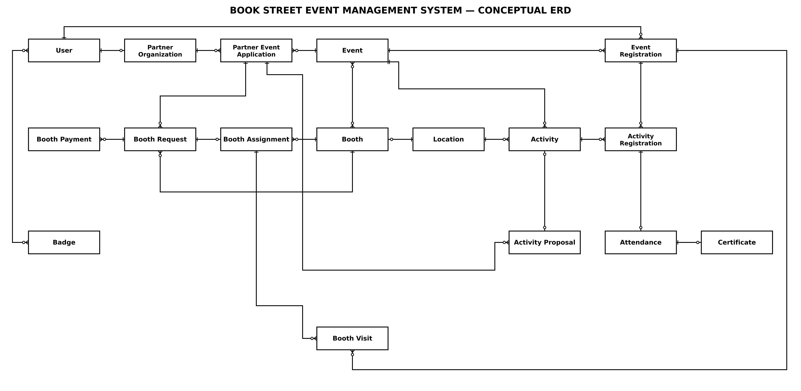

**BOOK STREET EVENT MANAGEMENT SYSTEM**

SWP391 \| Baseline 2.1 \| 27/09/2026

> **Active MVP overlay (09/10/2026):** Conceptual structure remains unchanged. `BoothPayment`
> represents initial-rental payment attempts in the active MVP. Refund, Booth change/cancellation
> after Assignment and whole-Event Partner withdrawal are Post-MVP references and do not require a
> Conceptual ERD redraw.

**Mục đích tài liệu. Tài liệu này giải thích Core Conceptual ERD đã được nhóm và giảng viên duyệt cho hệ thống quản lý sự kiện Đường Sách. Bản 2.1 đồng bộ cách hiểu của sơ đồ với requirement, Logical ERD và Physical ERD hiện hành mà không thay đổi cấu trúc Conceptual đã chốt.**

**Kết luận chính. Baseline vẫn gồm 17 entity nghiệp vụ và 23 quan hệ. Không cần thêm hộp mới vào sơ đồ: User đại diện khái niệm tài khoản ở mức cao; Role, UserRole và user_tokens là cấu trúc triển khai. GeneralFeedback, ActivityRating, Notification và HeritageContent là các khái niệm hỗ trợ được mô tả đầy đủ từ Logical ERD, còn Core Conceptual chỉ giữ xương sống Event, Booth, Activity và Participant.**

# Những điểm baseline cần ghi nhớ

- BoothRequest nối trực tiếp tới Booth vì Partner chọn Booth ngay khi gửi request; việc submit request chưa tạo Hold.

- BoothPayment là entity nghiệp vụ cốt lõi của MVP vì một request có thể có nhiều transaction hoặc payment attempt cần lưu lịch sử.

- BoothAssignment chỉ xuất hiện sau khi có giao dịch thanh toán hợp lệ được backend xác minh.

- Event và Booth là quan hệ nhiều nhiều ở mức Conceptual; EventBoothConfig sẽ giải quan hệ này ở Logical và Physical.

- Activity chỉ diễn ra tại Location. Không tạo quan hệ trực tiếp Activity với Booth vì Booth là một loại Location.

- BoothVisit, Badge và Certificate được giữ trong Conceptual vì chúng thể hiện kết quả nghiệp vụ mà Participant nhận được.

**Hình 1 Conceptual ERD đã duyệt**

*Ký pháp Crow’s Foot thể hiện lực lượng ở hai đầu quan hệ. Sơ đồ không chứa attribute, PK, FK hoặc datatype.*

# 1 Phạm vi của Conceptual ERD

Conceptual ERD trả lời ba câu hỏi: hệ thống quản lý những khái niệm nghiệp vụ nào, các khái niệm đó liên hệ với nhau ra sao và mỗi quan hệ có lực lượng như thế nào. Sơ đồ chưa quyết định tên bảng, cột, khóa ngoại, enum, index hoặc cách tích hợp Payment Gateway.

Vì vậy, việc một khái niệm không xuất hiện trong Core Conceptual không có nghĩa là bị loại khỏi hệ thống. Username, password, email verification, Role/UserRole, user_tokens, GeneralFeedback và các request đổi hoặc hủy được đặc tả ở requirement, Logical hoặc Physical vì chúng không cần thiết để giải thích xương sống nghiệp vụ cấp cao. Admin vẫn là actor quản trị Account, Role và Badge, không phải một entity nghiệp vụ mới.

# 2 Danh mục entity nghiệp vụ

## 2.1 Tài khoản và sự kiện

| **Entity** | **Ý nghĩa nghiệp vụ**                                                                                                          |
|------------|--------------------------------------------------------------------------------------------------------------------------------|
| User       | Tài khoản người dùng hệ thống. User có thể tham gia Event, đại diện cho Partner Organization và nhận Badge.                    |
| Event      | Sự kiện Đường Sách đóng vai trò khung chứa việc Partner tham gia, Booth được mở, Activity được tổ chức và Participant đăng ký. |
| Location   | Địa điểm vật lý dùng chung cho các Activity. Booth được mô hình hóa là một loại Location chuyên biệt.                          |

## 2.2 Partner và quy trình Booth

| **Entity**                | **Ý nghĩa nghiệp vụ**                                                                                                           |
|---------------------------|---------------------------------------------------------------------------------------------------------------------------------|
| Partner Organization      | Tổ chức tham gia Event, ví dụ nhà xuất bản, thương hiệu hoặc đơn vị đồng hành. Tổ chức được tách khỏi tài khoản User đại diện.  |
| Partner Event Application | Đơn của Partner Organization xin tham gia một Event cụ thể. Đây là điều kiện đầu vào trước khi xin Booth hoặc đề xuất Activity. |
| Booth                     | Vị trí Booth vật lý. Một Booth có thể được mở với giá và trạng thái cho phép khác nhau giữa các Event.                          |
| Booth Request             | Yêu cầu của Partner cho một Booth cụ thể. Nhiều Partner có thể cùng request một Booth trước khi Organizer chọn candidate.       |
| Booth Payment             | Bản ghi giao dịch liên quan tới tiền Booth. Một request có thể có nhiều payment attempt; lịch sử không bị ghi đè.               |
| Booth Assignment          | Kết quả cấp Booth chính thức cho request thắng sau khi backend xác minh giao dịch thành công.                                   |

## 2.3 Đề xuất và tổ chức Activity

| **Entity**        | **Ý nghĩa nghiệp vụ**                                                                                               |
|-------------------|---------------------------------------------------------------------------------------------------------------------|
| Activity Proposal | Đề xuất Activity do Partner gửi. Proposal chưa phải Activity chính thức và có thể không được chuyển thành Activity. |
| Activity          | Hoạt động chính thức thuộc một Event và diễn ra tại một Location. Activity cũng có thể do Organizer tạo trực tiếp.  |

## 2.4 Trải nghiệm Participant

| **Entity**            | **Ý nghĩa nghiệp vụ**                                                                                                                       |
|-----------------------|---------------------------------------------------------------------------------------------------------------------------------------------|
| Event Registration    | Bản ghi một User tham gia một Event. Đây là gốc của các đăng ký Activity và lịch sử Booth Visit trong Event đó.                             |
| Activity Registration | Bản ghi Participant đăng ký một Activity thuộc Event đã tham gia.                                                                           |
| Attendance            | Bằng chứng Participant thực sự tham dự Activity; đăng ký Activity không tự động đồng nghĩa với đã tham dự.                                  |
| Booth Visit           | Bản ghi Participant ghé Booth thông qua Booth QR. Visit gắn với Event Registration và Booth Assignment đang có hiệu lực.                    |
| Badge                 | Phần thưởng nghiệp vụ User có thể đạt được từ điều kiện tích lũy visit hoặc điểm. Bảng nối UserBadge chỉ xuất hiện ở Logical hoặc Physical. |
| Certificate           | Chứng nhận có thể được cấp từ Attendance hợp lệ sau khi Activity hoàn tất.                                                                  |

# 3 Quan hệ và cardinality đã chốt

Ký hiệu 1 nghĩa là đúng một, 0..1 nghĩa là không có hoặc tối đa một, và 0..N nghĩa là không có hoặc có nhiều. Quan hệ nhiều nhiều được ghi là 0..N ở cả hai phía.

## 3.1 Tài khoản Partner và Event

| **Quan hệ**                                      | **Cardinality** | **Cách hiểu**                                                                                        |
|--------------------------------------------------|-----------------|------------------------------------------------------------------------------------------------------|
| User — Partner Organization                      | 1 — 0..1        | Một User có thể đại diện tối đa một Partner; mỗi Partner có một User đại diện trong phạm vi MVP.     |
| Partner Organization — Partner Event Application | 1 — 0..N        | Một Partner có thể nộp nhiều application cho các Event khác nhau; mỗi application thuộc một Partner. |
| Event — Partner Event Application                | 1 — 0..N        | Một Event có thể nhận nhiều application; mỗi application nhắm tới đúng một Event.                    |
| User — Event Registration                        | 1 — 0..N        | Một User có thể tham gia nhiều Event; mỗi Event Registration thuộc một User.                         |
| Event — Event Registration                       | 1 — 0..N        | Một Event có thể có nhiều Participant registration; mỗi registration thuộc một Event.                |

## 3.2 Booth request payment và assignment

| **Quan hệ**                               | **Cardinality** | **Cách hiểu**                                                                                           |
|-------------------------------------------|-----------------|---------------------------------------------------------------------------------------------------------|
| Partner Event Application — Booth Request | 1 — 0..N        | Application hợp lệ có thể tạo nhiều Booth Request theo rule của Event.                                  |
| Booth — Booth Request                     | 1 — 0..N        | Một Booth có thể nhận nhiều request cạnh tranh; mỗi request chỉ nhắm tới một Booth.                     |
| Booth Request — Booth Payment             | 1 — 0..N        | Một request có thể chưa thanh toán hoặc có nhiều transaction/payment attempt được lưu riêng.            |
| Booth Request — Booth Assignment          | 1 — 0..1        | Một request chỉ có tối đa một assignment; assignment chỉ được tạo khi luồng thanh toán hoàn tất hợp lệ. |
| Booth — Booth Assignment                  | 1 — 0..N        | Một Booth có thể được cấp ở nhiều Event hoặc thời điểm khác nhau; mỗi assignment chỉ cấp một Booth.     |
| Event — Booth                             | 0..N — 0..N     | Event có thể mở nhiều Booth và một Booth vật lý có thể được tái sử dụng qua nhiều Event.                |
| Location — Booth                          | 1 — 0..1        | Mỗi Booth là đúng một Location; một Location có thể không phải Booth.                                   |

## 3.3 Activity proposal và đăng ký

| **Quan hệ**                                   | **Cardinality** | **Cách hiểu**                                                                                                   |
|-----------------------------------------------|-----------------|-----------------------------------------------------------------------------------------------------------------|
| Event — Activity                              | 1 — 0..N        | Một Event có thể có nhiều Activity; mỗi Activity thuộc đúng một Event.                                          |
| Location — Activity                           | 1 — 0..N        | Một Location có thể tổ chức nhiều Activity theo thời gian; mỗi Activity diễn ra tại một Location.               |
| Partner Event Application — Activity Proposal | 1 — 0..N        | Partner tham gia Event có thể gửi nhiều proposal.                                                               |
| Activity Proposal — Activity                  | 0..1 — 0..1     | Proposal có thể không trở thành Activity; Activity cũng có thể do Organizer tạo trực tiếp mà không có proposal. |
| Event Registration — Activity Registration    | 1 — 0..N        | Một lần tham gia Event có thể chứa nhiều đăng ký Activity.                                                      |
| Activity — Activity Registration              | 1 — 0..N        | Một Activity có thể có nhiều Participant đăng ký; mỗi registration chỉ trỏ tới một Activity.                    |
| Activity Registration — Attendance            | 1 — 0..1        | Một registration có thể chưa có hoặc có một attendance hợp lệ.                                                  |
| Attendance — Certificate                      | 1 — 0..1        | Attendance hợp lệ có thể tạo tối đa một Certificate.                                                            |

## 3.4 Booth Visit và Badge

| **Quan hệ**                      | **Cardinality** | **Cách hiểu**                                                                                |
|----------------------------------|-----------------|----------------------------------------------------------------------------------------------|
| Event Registration — Booth Visit | 1 — 0..N        | Một Participant trong Event có thể ghé nhiều Booth; mỗi visit thuộc một Event Registration.  |
| Booth Assignment — Booth Visit   | 1 — 0..N        | Một Booth Assignment có thể nhận nhiều lượt visit; mỗi visit ghi nhận một assignment cụ thể. |
| User — Badge                     | 0..N — 0..N     | Một User có thể nhận nhiều Badge và một loại Badge có thể được trao cho nhiều User.          |

# 4 Các luồng nghiệp vụ được thể hiện

## 4.1 Partner đăng ký và thanh toán Booth

Partner Organization nộp Partner Event Application cho Event. Sau khi đủ điều kiện tham gia, Partner tạo Booth Request cho Booth mong muốn. Việc submit request chưa giữ hoặc khóa Booth. Organizer chọn một candidate, sau đó hệ thống mới tạo cơ chế giữ chỗ ở tầng Logical hoặc Physical và mở payment window.

Mỗi lần thanh toán được lưu thành một Booth Payment riêng. Payment attempt thất bại không tự động kết thúc toàn bộ quy trình nếu payment window vẫn còn hiệu lực; Partner có thể retry. Khi có transaction thành công, được backend xác minh và Event còn PUBLISHED/ONGOING, hệ thống tạo Booth Assignment. Các request cạnh tranh còn lại kết thúc với trạng thái NOT_SELECTED. Nếu payment window hết hạn và không có evidence chưa rõ, Hold được giải phóng; evidence chưa rõ tiếp tục giữ Hold nhưng không dừng Event lifecycle.

## 4.2 Partner đề xuất Activity

Partner Event Application có thể tạo nhiều Activity Proposal. Proposal được duyệt có thể trở thành Activity, nhưng Activity cũng có thể do Organizer tạo trực tiếp. Activity luôn thuộc một Event và diễn ra tại một Location.

Không nối Activity trực tiếp với Booth. Nếu một Activity diễn ra tại Booth A05, đường truy xuất nghiệp vụ là Activity đến Location A05, sau đó Location đó được xác định là Booth. Cách này cho phép Main Stage, Workshop Area và Booth sử dụng chung mô hình địa điểm.

## 4.3 Participant tham gia Event và Activity

User tham gia Event thông qua Event Registration. Từ registration này, User có thể đăng ký nhiều Activity. Activity Registration chỉ thể hiện ý định tham gia; Attendance mới là bằng chứng đã tham dự. Certificate chỉ được xét khi Attendance hợp lệ và Activity đã ở trạng thái COMPLETED.

## 4.4 Participant ghé Booth và nhận Badge

Khi Participant tự quét Booth QR, hệ thống tạo Booth Visit cho Event Registration và Booth Assignment tương ứng. Các visit hoặc điểm tích lũy có thể được dùng để xét Badge. PointTransaction và UserBadge không xuất hiện ở Conceptual vì chúng là cấu trúc triển khai chi tiết hơn.

# 5 Các quyết định mô hình hóa quan trọng

| **Quyết định**                                  | **Lý do**                                                                                                                                                                     |
|-------------------------------------------------|-------------------------------------------------------------------------------------------------------------------------------------------------------------------------------|
| BoothRequest phải nối trực tiếp Booth           | Partner chọn Booth trước khi Organizer review và trước khi có Hold. Vì vậy Booth mục tiêu là dữ liệu nghiệp vụ của request, không được suy ngược qua BoothHold.               |
| BoothHold không phải entity Conceptual          | Hold là cơ chế kiểm soát cạnh tranh và payment window. Nó cần ở Logical và Physical nhưng không phải khái niệm trung tâm khi giải thích nghiệp vụ cấp cao.                    |
| EventBoothConfig chưa xuất hiện thành hộp riêng | Quan hệ Event và Booth được giữ ở dạng M:N. Logical ERD sẽ bổ sung EventBoothConfig với eventId, boothId, rentalPrice và isEnabled; cặp eventId và boothId là duy nhất.       |
| BoothPayment được giữ trong Conceptual          | Initial Booth payment thuộc MVP và có lịch sử riêng. Khả năng biểu diễn refund được giữ làm extension Post-MVP; không tạo Refund entity riêng.                               |
| Giá đang giao dịch phải được cố định            | Khi bắt đầu thanh toán, amount được snapshot từ giá Booth của Event. Thay đổi cấu hình giá sau đó không làm thay đổi transaction đang chạy hoặc Booth đã được chốt.           |
| Không nối Activity với Booth                    | Activity chỉ cần Location. Booth là một trường hợp chuyên biệt của Location, nên quan hệ trực tiếp sẽ trùng nghĩa và gây lệch mô hình.                                        |
| Không đưa request đổi hủy vào Conceptual        | BoothChangeRequest, BoothCancellationRequest và PartnerWithdrawalRequest hiện là Post-MVP reference, không cần thiết để trình bày xương sống nghiệp vụ.                      |

# 6 Tác động khi chuyển sang Logical và Physical ERD

Logical ERD và Physical ERD hiện hành đã giữ nguyên ý nghĩa của Conceptual và bổ sung các cấu trúc cần thiết để triển khai:

- Giải quan hệ Event — Booth bằng EventBoothConfig(eventId, boothId, rentalPrice, isEnabled) và UNIQUE(eventId, boothId).

- Bổ sung BoothHold sau khi Organizer chọn candidate; Active Hold và Active Assignment mới tạo exclusivity.

- Active BoothRequest dùng PENDING, SELECTED, COMPLETED, PAYMENT_EXPIRED, NOT_SELECTED, REJECTED, WITHDRAWN và CANCELLED. BoothChangeRequest là Post-MVP.

- Cho phép nhiều BoothPayment record cho cùng request hoặc hold; không overwrite attempt cũ.

- Bổ sung bảng nối UserBadge và PointTransaction nếu chức năng điểm thưởng cần truy vết chi tiết.

- Bổ sung User, Role, UserRole và bảng kỹ thuật user_tokens; username là duy nhất không phân biệt hoa thường, email tùy chọn với Participant nhưng phải xác minh trước khi cấp PARTNER, ORGANIZER hoặc ADMIN.

- GeneralFeedback có đúng một target BOOK_STREET hoặc EVENT. Heritage, Location và Activity không phải GeneralFeedback target. ActivityRating vẫn tách riêng và yêu cầu Attendance hợp lệ.

- Bổ sung change, cancellation và withdrawal request cùng audit cần thiết mà không làm thay đổi các quan hệ cốt lõi trong Conceptual.

- Không đặt rentalPrice trên Booth vật lý; giá thuộc cấu hình Booth theo từng Event và được snapshot vào BoothPayment khi giao dịch bắt đầu.

# 7 Kết luận

Core Conceptual ERD này vẫn là baseline nghiệp vụ đã được duyệt và không cần vẽ lại sau các quyết định mới. Logical và Physical đã cụ thể hóa tài khoản, phân quyền, feedback và token kỹ thuật mà không làm thay đổi 17 entity cốt lõi. Team tiếp tục giữ các quyết định: request trước Hold, payment success trước Assignment, EventBoothConfig ở Logical và Physical, Activity chỉ gắn Location, và lịch sử payment hoặc visit không bị ghi đè.
