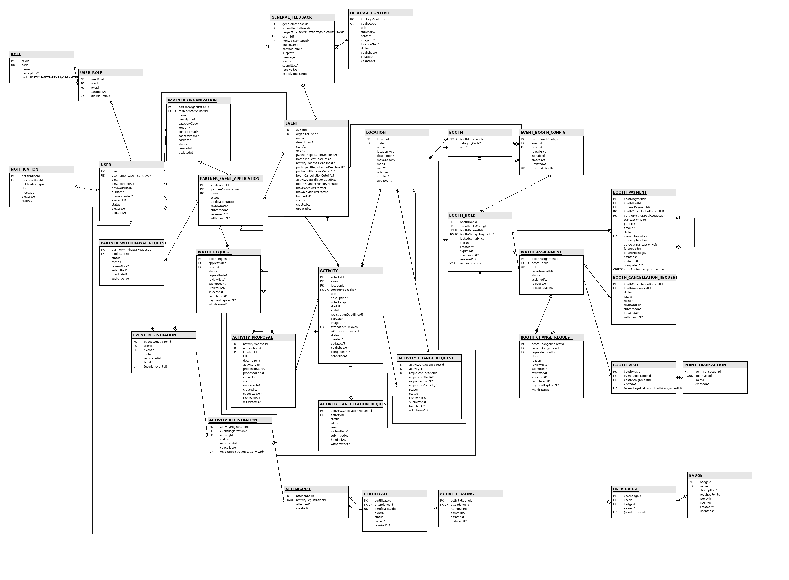
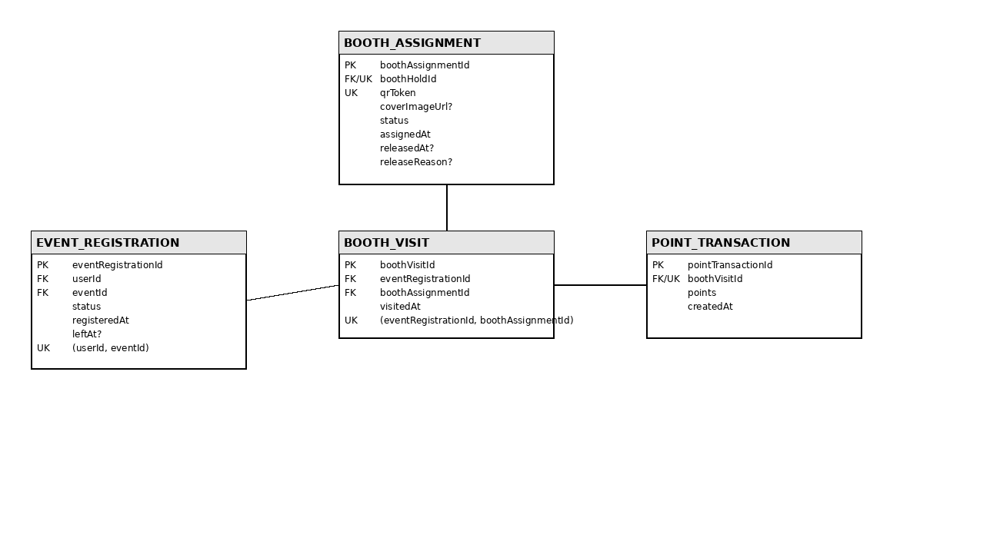

# **BÁO CÁO MÔ TẢ LOGICAL ERD**

## *BOOK STREET EVENT MANAGEMENT SYSTEM*

**SWP391  |  Logical Data Model v8 — Sprint 5 Activity Baseline with Post-MVP Reference Overlay**

Mục đích: giúp toàn bộ team hiểu active MVP model và target model tương lai. Logical v8 khóa
Activity planning cho Sprint 5; hình v7 vẫn là ảnh tổng quan tham khảo cho cardinality. Ba entity
`BoothChangeRequest`, `BoothCancellationRequest`, `PartnerWithdrawalRequest` tiếp tục là
`POST-MVP REFERENCE`, không phải nguồn tạo table/API hiện tại.

# **Kết luận chính**

Active MVP giữ riêng Request, Hold, initial Payment và Assignment; dùng EventBoothConfig để cấu
hình Booth theo từng Event; tách đăng ký khỏi tham dự thực tế; và giữ lịch sử giao dịch thay vì ghi
đè dữ liệu cũ. Các entity đổi/hủy Booth sau Assignment và whole-Event Partner withdrawal chỉ mô tả
hướng mở rộng sau MVP.

Tài liệu tập trung vào ý nghĩa của từng entity và các ràng buộc cần được team hiểu thống nhất. PK, FK, datatype, index và câu lệnh database sẽ được chốt ở Physical ERD.

# **1\. Phạm vi của Logical ERD**

| Nhóm nghiệp vụ | Số entity | Nội dung chính |
| :---- | :---- | :---- |
| Tài khoản và phân quyền | 3 | User, Role và UserRole. |
| Partner và Event | 3 | PartnerOrganization, PartnerEventApplication và Event. |
| Booth và thanh toán | 7 active + 3 Post-MVP | Active: Location, Booth, EventBoothConfig, BoothRequest, BoothHold, BoothPayment, BoothAssignment. Post-MVP: ba request thay đổi/hủy/rút Event. |
| Activity | 4 | Proposal, Activity, Change Request và Cancellation Request. |
| Participant và attendance | 4 | EventRegistration, ActivityRegistration, Attendance và BoothVisit. |
| Reward | 4 | PointTransaction, Badge, UserBadge và Certificate. |
| Giao tiếp và nội dung | 4 | ActivityRating, Notification, GeneralFeedback và HeritageContent. |

# **2\. Sơ đồ Logical ERD**

Hình dưới đây là bản Logical ERD tổng quan. Các entity có nhiều quan hệ được đặt gần trung tâm; mọi quan hệ dùng Crow’s Foot để thể hiện cardinality.

*Hình 1\. PNG tổng quan là ảnh legacy. File drawio nguồn và phần mô tả bên dưới là nguồn hiện hành. GeneralFeedback không còn quan hệ với HeritageContent.*

Quan hệ EventRegistration \- BoothVisit được trình bày thêm ở hình chi tiết để sơ đồ tổng quan không bị rối. Đây vẫn là cùng một data model, không phải entity bị tách thành module độc lập.

*Hình 2\. Chi tiết quan hệ ghi nhận lượt ghé Booth*

# **3\. Cách đọc và các nguyên tắc thiết kế**

| Ký hiệu | Cách hiểu |
| :---- | :---- |
| 1 | Mỗi record bắt buộc liên kết với đúng một record ở phía còn lại. |
| 0..1 | Liên kết có thể chưa tồn tại, nhưng tối đa chỉ có một. |
| 0..N | Có thể chưa có record nào hoặc có nhiều record. |
| PK | Khóa chính định danh duy nhất record. |
| FK | Khóa ngoại nối sang entity khác. |
| UK | Ràng buộc duy nhất, ngăn dữ liệu trùng theo nghiệp vụ. |
| XOR | Chỉ một trong các nguồn hoặc target được phép tồn tại tại cùng thời điểm. |

* Entity nghiệp vụ được giữ riêng khi có vòng đời, trạng thái hoặc lịch sử cần audit.  
* Không hard-delete dữ liệu đã phát sinh nghiệp vụ; kết thúc vòng đời bằng status và timestamp.  
* Giá Booth được cấu hình theo Event và được snapshot khi bắt đầu Hold để thay đổi giá sau đó không làm đổi giao dịch đang chạy.  
* Một payment attempt thất bại không đồng nghĩa toàn bộ payment process thất bại; Partner chỉ được retry khi Hold còn ACTIVE và backend time chưa tới `expiresAt`.
* Payment window hết hạn mới release Hold và cho Organizer chọn candidate khác.  
* Activity QR thuộc Activity; Booth QR thuộc BoothAssignment. QR không được tạo thành entity riêng trong Logical ERD.

# **4\. Tài khoản và phân quyền**

### **User**

**Vai trò: Lưu tài khoản đăng nhập và thông tin nhận diện cơ bản. User đăng ký bằng username, full name và password; confirm password chỉ dùng để kiểm tra ở giao diện và không được lưu. Email là tùy chọn đối với Participant.**

**Khi nào phát sinh:** Khi cá nhân đăng ký hoặc được tạo tài khoản.

**Ý nghĩa và vòng đời: Username là duy nhất không phân biệt hoa thường. User có status để khóa hoặc kích hoạt; email phải được xác minh trước khi cấp PARTNER, ORGANIZER hoặc ADMIN. Dữ liệu Participant, đại diện Partner, Organizer và Admin đều quy về User; quyền cụ thể đi qua UserRole.**

**Quan hệ chính:** Liên kết UserRole, PartnerOrganization, Event, EventRegistration, UserBadge, Notification và GeneralFeedback.

**Ví dụ:** Tài khoản của một khách tham dự đồng thời là người đại diện cho một nhà xuất bản.

### **Role**

**Vai trò: Danh mục vai trò nghiệp vụ gồm PARTICIPANT, PARTNER, ORGANIZER và ADMIN.**

**Khi nào phát sinh:** Khi hệ thống cấu hình bộ vai trò được hỗ trợ.

**Ý nghĩa và vòng đời:** Role là dữ liệu chuẩn và không chứa thông tin người dùng. Thay đổi tên hoặc quyền cần được kiểm soát để không làm sai phân quyền.

**Quan hệ chính:** Quan hệ nhiều nhiều với User thông qua UserRole.

**Ví dụ:** Role ORGANIZER cho phép vận hành Event và xét các request.

### **UserRole**

**Vai trò:** Entity liên kết giúp một User có nhiều Role và một Role được gán cho nhiều User.

**Khi nào phát sinh:** Khi hệ thống cấp thêm một vai trò cho User.

**Ý nghĩa và vòng đời:** Mỗi cặp User và Role chỉ được tồn tại một lần. assignedAt giúp truy vết thời điểm cấp vai trò.

**Quan hệ chính:** Thuộc đúng một User và đúng một Role.

**Ví dụ:** Một User có cả PARTICIPANT và PARTNER.

# **5\. Partner và Event**

### **PartnerOrganization**

**Vai trò:** Đại diện cho tổ chức tham gia Đường Sách, tách biệt với tài khoản cá nhân đăng nhập.

**Khi nào phát sinh:** Khi Partner tạo hoặc hoàn tất hồ sơ tổ chức.

**Ý nghĩa và vòng đời:** Trong MVP, một User đại diện chính cho tối đa một PartnerOrganization. Tổ chức có category để hỗ trợ recommend hoặc cảnh báo Booth, không dùng để hard-lock.

**Quan hệ chính:** Có representative User và nhiều PartnerEventApplication.

**Ví dụ:** NXB Kim Đồng hoặc một thương hiệu sách độc lập.

### **PartnerEventApplication**

**Vai trò:** Đơn của Partner xin tham gia một Event cụ thể; đây là cửa vào trước khi request Booth hoặc gửi Activity Proposal.

**Khi nào phát sinh:** Khi Partner submit hồ sơ tham gia Event.

**Ý nghĩa và vòng đời:** Đơn đi qua các trạng thái xét duyệt và có thể được rút. Chỉ application hợp lệ và đã được duyệt mới được tạo các nghiệp vụ Booth hoặc Activity.

**Quan hệ chính:** Nối PartnerOrganization với Event; là cha của BoothRequest, ActivityProposal và PartnerWithdrawalRequest.

**Ví dụ:** Kim Đồng apply tham gia Lễ hội Đường Sách Mùa Thu.

### **Event**

**Vai trò:** Sự kiện lớn chứa lịch, deadline, các hoạt động, cấu hình Booth và lượt tham gia.

**Khi nào phát sinh:** Khi Organizer tạo kế hoạch Event.

**Ý nghĩa và vòng đời:** Event đi qua DRAFT, PUBLISHED, ONGOING, COMPLETED hoặc CANCELLED. Các cutoff và payment window thuộc Event để rule có thể khác nhau giữa các sự kiện.

**Quan hệ chính:** Có Organizer User, PartnerEventApplication, EventBoothConfig, Activity, EventRegistration và GeneralFeedback.

**Ví dụ:** Lễ hội Đường Sách Mùa Thu 2026\.

# **6\. Không gian Booth và thanh toán**

### **Location**

**Vai trò:** Khái niệm chung cho mọi vị trí vật lý trong Đường Sách.

**Khi nào phát sinh:** Khi Ban quản lý khai báo Booth, sân khấu, khu workshop hoặc khu vực chức năng.

**Ý nghĩa và vòng đời:** Location giữ capacity và trạng thái vận hành. Booth là subtype của Location; vì vậy Activity chỉ cần nối Location, không nối Booth trực tiếp.

**Quan hệ chính:** Có thể có một Booth subtype và được nhiều Activity hoặc ActivityProposal sử dụng ở các thời điểm khác nhau.

**Ví dụ:** Main Stage, Workshop Area hoặc vị trí A05.

### **Booth**

**Vai trò:** Phần mở rộng của Location dành riêng cho vị trí gian hàng.

**Khi nào phát sinh:** Khi một Location được xác định là Booth.

**Ý nghĩa và vòng đời:** Booth không có giá thuê cố định và không có trạng thái ASSIGNED toàn cục. categoryCode chỉ hỗ trợ gợi ý hoặc cảnh báo.

**Quan hệ chính:** Dùng trong EventBoothConfig, BoothRequest và BoothChangeRequest.

**Ví dụ:** Booth A05 có thể được dùng ở nhiều Event không trùng thời gian.

### **EventBoothConfig**

**Vai trò:** Cấu hình một Booth trong phạm vi một Event, gồm giá thuê và việc Booth có được mở hay không.

**Khi nào phát sinh:** Khi Organizer đưa Booth vào sơ đồ hoặc danh sách Booth của Event.

**Ý nghĩa và vòng đời:** Mỗi cặp Event và Booth là duy nhất. rentalPrice thuộc config này, không nằm trên Booth. isEnabled chỉ cho biết Booth có mở trong Event; AVAILABLE, ON\_HOLD và ASSIGNED là trạng thái runtime suy ra từ Hold và Assignment. Không được disable config khi còn Active Hold hoặc Assignment.

**Quan hệ chính:** Thuộc một Event và một Booth; được BoothHold tham chiếu.

**Ví dụ:** A05 giá 2.000.000 đồng trong Event E1 nhưng 2.500.000 đồng trong Event E2.

### **BoothRequest**

**Vai trò:** Yêu cầu của một Partner đã được duyệt để xin một Booth cụ thể.

**Khi nào phát sinh:** Khi Partner chọn Booth và submit request.

**Ý nghĩa và vòng đời:** Submit không tạo Hold và không khóa Booth. Nhiều Partner có thể PENDING cùng Booth. Organizer chọn một candidate thì request chuyển SELECTED; payment success chuyển COMPLETED; hết payment window chuyển PAYMENT\_EXPIRED; candidate khác chỉ thành NOT\_SELECTED sau khi có người hoàn tất.

**Quan hệ chính:** Thuộc PartnerEventApplication, nhắm tới Booth và có thể tạo tối đa một Hold đang xử lý tại một thời điểm.

**Ví dụ:** Bốn Partner cùng request A05, nhưng chưa ai khóa A05 ở bước submit.

### **BoothHold**

**Vai trò:** Giữ Booth tạm thời sau khi Organizer chọn candidate.

**Khi nào phát sinh:** Khi request được SELECTED và bắt đầu payment window.

**Ý nghĩa và vòng đời:** Hold tạo exclusivity theo Event và Booth. lockedRentalPrice snapshot giá tại lúc chọn. Hold có ACTIVE, CONSUMED hoặc RELEASED/EXPIRED; attempt thất bại không release Hold nếu window còn hạn. Active MVP chỉ dùng BoothRequest làm nguồn Hold. Partner được release sớm Hold khi mọi payment evidence đã terminal an toàn và chưa có Assignment.

**Quan hệ chính:** Nối EventBoothConfig với đúng một nguồn request; là cha của BoothPayment và có thể sinh BoothAssignment.

**Ví dụ:** H01 giữ A05 trong 15 phút cho Partner B thanh toán.

### **BoothPayment**

**Vai trò:** Sổ payment attempt cho tiền thuê Booth ban đầu. V7 giữ `REFUND` như extension point Post-MVP nhưng active MVP không tạo refund.

**Khi nào phát sinh:** Mỗi lần Partner tạo initial-rental payment attempt.

**Ý nghĩa và vòng đời:** Mỗi retry là một record riêng, không ghi đè attempt cũ. amount là snapshot. Assignment chỉ dựa trên transaction PAYMENT SUCCESS đã được backend verify. Refund workflow không thuộc active MVP.

**Quan hệ chính:** Thuộc BoothHold. `originalPayment`, `transactionType=REFUND` và purpose tương lai tồn tại trong physical schema nhưng chưa có active workflow.

**Ví dụ:** Payment \#1 FAILED, Payment \#2 SUCCESS.

### **BoothAssignment**

**Vai trò:** Ghi nhận Booth đã được cấp chính thức cho Partner trong Event.

**Khi nào phát sinh:** Sau PAYMENT SUCCESS đã được backend xác minh hoặc atomic zero-price settlement.

**Ý nghĩa và vòng đời:** Assignment liên kết duy nhất với BoothHold để không lặp lại boothRequestId. Active MVP không cho đổi/hủy sau Assignment. qrToken thuộc Assignment để ghi nhận BoothVisit.

**Quan hệ chính:** Thuộc một BoothHold và có BoothVisit. Quan hệ tới request đổi/hủy là Post-MVP.

**Ví dụ:** A05 chính thức được cấp cho Partner B sau payment success.

### **BoothChangeRequest — POST-MVP REFERENCE**

**Vai trò:** Yêu cầu đổi từ Booth đang được cấp sang một Booth khác.

**Khi nào phát sinh:** Khi Partner có Assignment ACTIVE và muốn đổi vị trí.

**Ý nghĩa và vòng đời:** Submit chưa Hold Booth mới. Khi Organizer chọn, tạo replacement Hold; Booth cũ vẫn ACTIVE. Giá chênh lệch lấy từ EventBoothConfig: cao hơn cần PAYMENT SUCCESS, thấp hơn tạo REFUND PENDING, bằng nhau không cần giao dịch. Hết window thì release Hold mới và giữ Booth cũ.

**Quan hệ chính:** Nối current BoothAssignment, requested Booth và có thể là nguồn của BoothHold.

**Ví dụ:** Đổi A05 giá 2 triệu sang A10 giá 2,5 triệu và trả thêm 500 nghìn.

### **BoothCancellationRequest — POST-MVP REFERENCE**

**Vai trò:** Yêu cầu hủy Booth đang được cấp.

**Khi nào phát sinh:** Khi Partner muốn trả Booth trước Event hoặc trong thời gian được phép.

**Ý nghĩa và vòng đời:** Request giữ lý do, late flag, kết quả và thời điểm xử lý. Refund áp dụng boothCancellationCutoffAt của Event. Khi hủy hợp lệ, hệ thống ghi REFUND PENDING nếu có tiền hoàn rồi release Assignment theo quy trình.

**Quan hệ chính:** Thuộc BoothAssignment; tác động đến Payment, Assignment và các Activity phụ thuộc vị trí.

**Ví dụ:** Partner hủy trước cutoff và được hoàn 100 phần trăm.

### **PartnerWithdrawalRequest — POST-MVP REFERENCE**

**Vai trò:** Yêu cầu Partner rút khỏi toàn bộ Event.

**Khi nào phát sinh:** Khi Partner không còn tham gia Event.

**Ý nghĩa và vòng đời:** Organizer xác nhận và hệ thống xử lý tất cả Booth và Activity liên quan. Refund Booth dùng boothCancellationCutoffAt. Record không lưu handledByUserId theo baseline hiện tại.

**Quan hệ chính:** Thuộc PartnerEventApplication và kéo theo xử lý các Assignment, Proposal hoặc Activity của application.

**Ví dụ:** Partner rút Event, Booth được release và các Activity được move hoặc cancel.

# **7\. Activity**

### **ActivityProposal**

**Vai trò:** Đề xuất Activity do Partner gửi với thời gian, Location và capacity cụ thể.

**Khi nào phát sinh:** Sau khi PartnerEventApplication được duyệt; create là submit ngay thành
PENDING, không có Draft Proposal.

**Ý nghĩa và vòng đời:** `PENDING` không khóa Location hay quota. Vòng đời là PENDING →
NEED_CHANGES/APPROVED/REJECTED/WITHDRAWN/CANCELLED; NEED_CHANGES có thể resubmit về PENDING.
Trước approve phải kiểm tra lại Event, application, Booth ownership, Location, conflict, quota và
capacity. Một Proposal tạo tối đa một Activity; multi-session nằm ngoài MVP.

**Quan hệ chính:** Thuộc PartnerEventApplication và Location; có thể sinh 0..1 Activity.

**Ví dụ:** Đề xuất workshop ký sách tại Workshop Area lúc 09:00.

### **Activity**

**Vai trò:** Hoạt động chính thức trong Event, có thể còn Draft trước khi công bố.

**Khi nào phát sinh:** Khi Organizer tạo trực tiếp hoặc approve một ActivityProposal.

**Ý nghĩa và vòng đời:** Activity thuộc đúng một Event và Location. DRAFT → PUBLISHED → ONGOING →
COMPLETED; trạng thái không terminal có thể chuyển CANCELLED. Không có persisted RESCHEDULED;
reschedule là audited update. `registrationRequired` quyết định có registration deadline, QR và
Certificate hay không. QR chỉ được tạo một lần khi publish Activity yêu cầu registration.

**Quan hệ chính:** Liên kết Event, Location, optional source Proposal, registrations, change/cancellation requests.

**Ví dụ:** Talkshow, workshop, mini game hoặc lễ khai mạc.

### **ActivityChangeRequest**

**Vai trò:** Yêu cầu Partner thay đổi title, nội dung, loại, Location, thời gian, capacity hoặc ảnh
của Activity chính thức.

**Khi nào phát sinh:** Khi Partner muốn sửa Activity đã được duyệt hoặc publish.

**Ý nghĩa và vòng đời:** Partner không sửa Activity trực tiếp. Request phải tạo thay đổi thực; cặp
thời gian đi cùng nhau; merged candidate được kiểm tra ở submit và approve. Trạng thái dùng
PENDING/APPROVED/REJECTED/WITHDRAWN/CANCELLED. Một Activity chỉ có tối đa một Pending request tổng
cộng với Cancellation Request. Notification Participant được triển khai cùng module Participant.

**Quan hệ chính:** Thuộc Activity; requestedLocationId là tùy chọn nếu yêu cầu đổi địa điểm.

**Ví dụ:** Dời workshop từ 09:00 sang 14:00 tại Workshop Area 2\.

### **ActivityCancellationRequest**

**Vai trò:** Yêu cầu hủy Activity chính thức.

**Khi nào phát sinh:** Khi Partner không thể tiếp tục tổ chức Activity.

**Ý nghĩa và vòng đời:** Yêu cầu sau cutoff vẫn được ghi nhận nhưng đánh dấu late; đúng cutoff chưa
late. Submit không hủy Activity, approve mới atomically hủy và ghi cancellation metadata/source.
Request dùng cùng năm trạng thái với Change Request; Activity và lịch sử liên quan không bị xóa.

**Quan hệ chính:** Thuộc Activity và tác động đến ActivityRegistration, Attendance, Certificate.

**Ví dụ:** Partner xin hủy workshop sau activity cancellation cutoff.

# **8\. Participant Attendance và Reward**

### **EventRegistration**

**Vai trò:** Bản ghi User Join một Event để lưu My Events và nhận thông báo chung.

**Khi nào phát sinh:** Khi Participant bấm Join Event hoặc được tự động tạo lúc đăng ký Activity lần đầu.

**Ý nghĩa và vòng đời:** EventRegistration không giữ chỗ Activity và không có Event QR. Một User chỉ có một registration cho mỗi Event.

**Quan hệ chính:** Nối User với Event; là cha của ActivityRegistration và BoothVisit.

**Ví dụ:** Nguyễn Văn A Join Event Mùa Thu.

### **ActivityRegistration**

**Vai trò:** Bản ghi giữ chỗ của Participant cho một Activity cụ thể.

**Khi nào phát sinh:** Khi Participant đăng ký khi còn hạn và còn capacity.

**Ý nghĩa và vòng đời:** Capacity phải kiểm tra atomically. Registration có thể cancel hoặc no-show. QR không nằm ở record này; Participant dùng QR chung của Activity để self-scan, còn hệ thống xác định registration từ User đã đăng nhập.

**Quan hệ chính:** Thuộc EventRegistration và Activity; có tối đa một Attendance.

**Ví dụ:** A đăng ký Workshop viết truyện và chiếm một chỗ.

### **Attendance**

**Vai trò:** Bằng chứng Participant thực sự tham dự Activity.

**Khi nào phát sinh:** Khi Participant đăng nhập và self-scan QR của Activity hợp lệ.

**Ý nghĩa và vòng đời:** Một ActivityRegistration có tối đa một Attendance; scan lặp không tạo thêm record. Không dùng Attendance Operator, check-in/check-out hoặc duration trong baseline hiện tại. Attendance là điều kiện để rating và certificate.

**Quan hệ chính:** Thuộc duy nhất một ActivityRegistration; có thể sinh Certificate và ActivityRating.

**Ví dụ:** A self-scan tại Workshop và hệ thống ghi attendedAt.

### **BoothVisit**

**Vai trò:** Bằng chứng Participant đã ghé một Booth Assignment trong Event.

**Khi nào phát sinh:** Khi Participant self-scan QR của BoothAssignment.

**Ý nghĩa và vòng đời:** Mỗi cặp EventRegistration và BoothAssignment chỉ ghi nhận một lượt để tránh scan lặp lấy thêm điểm. Visit chỉ hợp lệ khi Assignment còn hiệu lực.

**Quan hệ chính:** Nối EventRegistration với BoothAssignment; có thể sinh một PointTransaction.

**Ví dụ:** A quét QR tại Booth A05 trong Event đang tham gia.

### **PointTransaction**

**Vai trò:** Bản ghi cộng điểm phát sinh từ BoothVisit hợp lệ.

**Khi nào phát sinh:** Sau khi BoothVisit thỏa điều kiện reward.

**Ý nghĩa và vòng đời:** Dùng mô hình ledger để không ghi đè tổng điểm. Mỗi BoothVisit tối đa tạo một transaction; tổng điểm của User được tính từ lịch sử giao dịch.

**Quan hệ chính:** Gắn duy nhất với BoothVisit và được dùng để đánh giá Badge.

**Ví dụ:** BoothVisit V01 tạo giao dịch cộng 10 điểm.

### **Badge**

**Vai trò:** Định nghĩa huy hiệu và ngưỡng điểm cần đạt.

**Khi nào phát sinh:** Khi Admin cấu hình loại Badge.

**Ý nghĩa và vòng đời:** Badge có thể bật hoặc tắt. Một Badge được nhiều User nhận và một User có nhiều Badge. requiredPoints là rule cấp tự động.

**Quan hệ chính:** Quan hệ nhiều nhiều với User thông qua UserBadge.

**Ví dụ:** Book Explorer yêu cầu tổng 100 điểm.

### **UserBadge**

**Vai trò:** Entity liên kết ghi nhận Badge mà User đã đạt.

**Khi nào phát sinh:** Khi tổng điểm của User đạt ngưỡng Badge và chưa nhận Badge đó.

**Ý nghĩa và vòng đời:** Mỗi cặp User và Badge chỉ tồn tại một lần; earnedAt giữ thời điểm cấp.

**Quan hệ chính:** Thuộc User và Badge.

**Ví dụ:** A nhận Badge Book Explorer.

### **Certificate**

**Vai trò:** Chứng nhận tham dự Activity.

**Khi nào phát sinh:** Chỉ khi Activity COMPLETED, Attendance hợp lệ và Activity bật certificate.

**Ý nghĩa và vòng đời:** Mỗi Attendance tối đa có một Certificate. certificateCode là duy nhất; có thể revoke nhưng không xóa lịch sử.

**Quan hệ chính:** Thuộc Attendance.

**Ví dụ:** Chứng nhận tham dự Workshop viết truyện.

# **9\. Giao tiếp Feedback và nội dung**

### **ActivityRating**

**Vai trò:** Đánh giá sao và nhận xét cho một Activity từ người đã tham dự.

**Khi nào phát sinh:** Sau khi User có Attendance hợp lệ.

**Ý nghĩa và vòng đời:** Mỗi Attendance tối đa có một rating, ngăn người chưa tham dự hoặc rating nhiều lần. ActivityRating tách khỏi GeneralFeedback vì target và điều kiện nghiệp vụ khác nhau.

**Quan hệ chính:** Thuộc Attendance, từ đó truy ngược được Activity và User.

**Ví dụ:** A chấm Workshop 5 sao sau khi tham dự.

### **Notification**

**Vai trò:** Thông báo trong hệ thống gửi đến một User.

**Khi nào phát sinh:** Khi có duyệt, từ chối, chọn candidate, payment, thay đổi lịch, hủy hoặc sự kiện quan trọng.

**Ý nghĩa và vòng đời:** Notification lưu type, title, message, createdAt và readAt. Đây là in-app notification; không đồng nghĩa bắt buộc có email hoặc SMS.

**Quan hệ chính:** Thuộc recipient User.

**Ví dụ:** Thông báo Activity đổi giờ và cho phép Participant cancel.

### **GeneralFeedback**

**Vai trò:** Góp ý chung của Guest hoặc User về đúng một target tại một thời điểm.

**Khi nào phát sinh:** Khi người dùng gửi góp ý về toàn Đường Sách hoặc một Event.

**Ý nghĩa và vòng đời:** XOR target bảo đảm feedback chỉ thuộc một trong hai loại BOOK\_STREET hoặc EVENT. Guest không cần đăng nhập và có thể cung cấp tên hoặc email liên hệ tùy chọn. HeritageContent không phải GeneralFeedback target.

**Quan hệ chính:** Có optional submittedByUserId và optional eventId theo targetType.

**Ví dụ:** Một góp ý về vệ sinh toàn Đường Sách, không đồng thời gắn một Event.

### **HeritageContent**

**Vai trò:** Nội dung công khai giới thiệu di sản, lịch sử hoặc giá trị văn hóa của Đường Sách.

**Khi nào phát sinh:** Khi Organizer tạo và publish nội dung.

**Ý nghĩa và vòng đời:** HeritageContent có publicCode và trạng thái publish. Đây là nội dung hỗ trợ public experience, không phải workflow quản lý di sản phức tạp.

**Quan hệ chính:** Độc lập với GeneralFeedback. HeritageContent chỉ phục vụ quản lý và hiển thị nội dung công khai.

**Ví dụ:** Bài viết về lịch sử hình thành Đường Sách.

# **10\. Các luồng dữ liệu chính**

## **10.1 Partner đăng ký Booth**

* PartnerOrganization tạo PartnerEventApplication và được Organizer duyệt.  
* Partner tạo BoothRequest cho một Booth; ở bước này chưa tạo Hold.  
* Organizer chọn candidate; hệ thống tạo BoothHold trên EventBoothConfig và snapshot lockedRentalPrice.  
* Partner có thể tạo nhiều BoothPayment attempt trong payment window.  
* PAYMENT SUCCESS đã được backend verify chỉ tạo BoothAssignment khi Event còn PUBLISHED/ONGOING; các candidate còn lại chuyển NOT\_SELECTED. Success sau COMPLETED/CANCELLED chỉ được giữ để đối soát.
* Nếu window hết hạn, Hold được release, request được chọn chuyển PAYMENT\_EXPIRED và các candidate khác vẫn PENDING.

## **10.2 Đổi hoặc hủy Booth — POST-MVP REFERENCE**

* BoothChangeRequest giữ Assignment cũ ACTIVE trong suốt thời gian xét duyệt và settlement.  
* Booth mới đắt hơn cần PAYMENT SUCCESS; rẻ hơn tạo REFUND PENDING; bằng giá không cần transaction.  
* Atomic swap chỉ xảy ra khi điều kiện settlement đạt; lỗi hoặc hết hạn giữ nguyên Booth cũ.  
* BoothCancellationRequest và PartnerWithdrawalRequest dùng boothCancellationCutoffAt để tính refund.

## **10.3 Activity và Participant**

* ActivityProposal được duyệt atomically tạo tối đa một Activity DRAFT; Organizer cũng có thể tạo
  Activity BTC trực tiếp tại shared non-Booth Location.
* Partner không cần Booth; nếu Activity dùng Booth thì cần Assignment ACTIVE của đúng Partner và
  Event ở cả submit/resubmit/approve.
* Proposal PENDING không khóa slot; Activity DRAFT trở đi khóa slot bằng conflict rule `[start,end)`.
* Change/Cancellation Request là hai khái niệm Logical nhưng có thể dùng một physical table chung
  để enforce đúng một Pending request trên mỗi Activity.
* `ActivityRevision` là bảng audit kỹ thuật Physical, không phải Actor-facing Use Case/entity mới;
  nó giữ old/new snapshot cho thay đổi đã áp dụng thay vì tạo status RESCHEDULED.
* Participant Join Event tạo EventRegistration; đăng ký Activity tạo ActivityRegistration.  
* Participant self-scan QR chung của Activity để tạo Attendance.  
* Attendance hợp lệ cho phép ActivityRating và Certificate khi đủ điều kiện.

## **10.4 Booth Visit và Reward**

* BoothAssignment mang QR của Booth trong Event.  
* Participant đã có EventRegistration self-scan QR tạo BoothVisit duy nhất.  
* BoothVisit hợp lệ tạo PointTransaction; tổng điểm được dùng để cấp UserBadge theo Badge rule.

# **11\. Những quyết định thiết kế cần nhớ**

| Quyết định | Lý do |
| :---- | :---- |
| BoothHold nối EventBoothConfig, không lặp boothId | Config đã xác định đồng thời Event, Booth và giá; lặp boothId tạo nguy cơ không nhất quán. |
| BoothAssignment chỉ nối BoothHold | Hold đã truy được BoothRequest và Booth; future model có thể mở rộng source mà không lặp Booth trên Assignment. |
| BoothPayment có transactionType và purpose | Active MVP dùng PAYMENT/INITIAL_BOOTH_RENTAL; REFUND và purpose đổi Booth là extension point Post-MVP. |
| Activity chỉ nối Location | Booth là subtype của Location; nối thêm Activity-Booth sẽ lặp quan hệ và không dùng được cho Main Stage hoặc Workshop Area. |
| Activity QR nằm trên Activity | Một QR chung tại địa điểm giúp Participant self-scan; Attendance vẫn gắn đúng ActivityRegistration của User. |
| Partner Activity ownership đi qua source Proposal | Không cần thêm partner_organization_id lặp trên Activity; Proposal → Application xác định owner và direct BTC Activity có source null. |
| Hai request Logical dùng một bảng Physical | Partial unique index theo activity_id và status PENDING chặn race giữa Change và Cancellation Request. |
| ActivityRevision chỉ là audit Physical | Giữ lịch sử old/new của reschedule/move/config change mà không làm phình lifecycle hoặc thêm Use Case. |
| Refund không có active MVP workflow | V7 giữ khả năng biểu diễn REFUND cho tương lai; không có endpoint/service tạo refund trong active MVP. |
| User-Badge dùng UserBadge | Quan hệ nhiều nhiều cần record earnedAt và uniqueness cho từng cặp User-Badge. |
| GeneralFeedback dùng XOR target | Mỗi feedback chỉ phản ánh một target: toàn Đường Sách hoặc một Event. HeritageContent không phải target. |

# **12\. Kiểm tra nhất quán và kết luận**

Trước khi chuyển sang Physical ERD, team cần chốt enum status và transition; datatype tiền tệ, timestamp và timezone; unique constraint, index, transaction locking; cùng các ràng buộc XOR của BoothHold và GeneralFeedback. Không đưa lại QR, Refund hoặc PaymentGatewayConfig thành entity nếu không có requirement mới.

Logical ERD này gồm active MVP model và Post-MVP reference overlay. Chỉ entity/rule được ghi active
MVP cùng Physical active-schema overlay mới được dùng để chia module, thiết kế API và migration.
Không triển khai ba request Post-MVP hoặc refund nếu chưa có một quyết định scope mới cập nhật đồng
bộ Business Rules, Use Case và Sprint contract.

