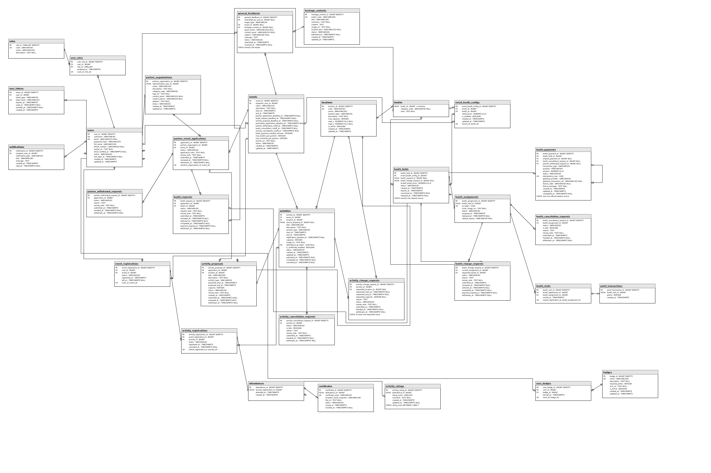
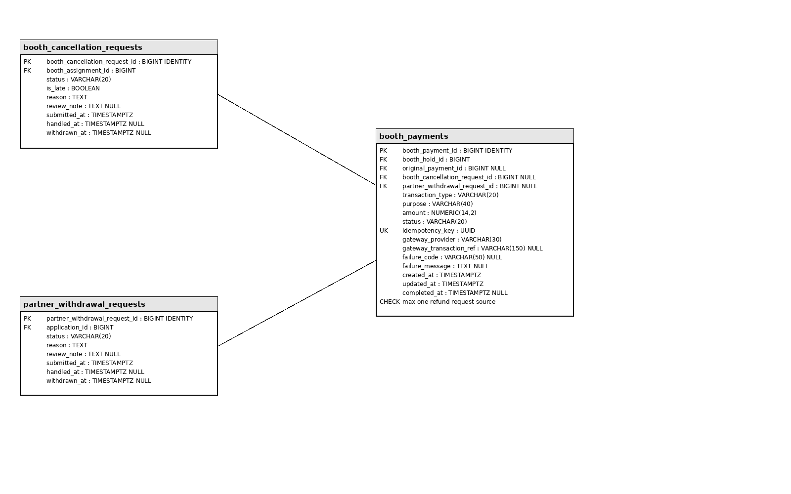
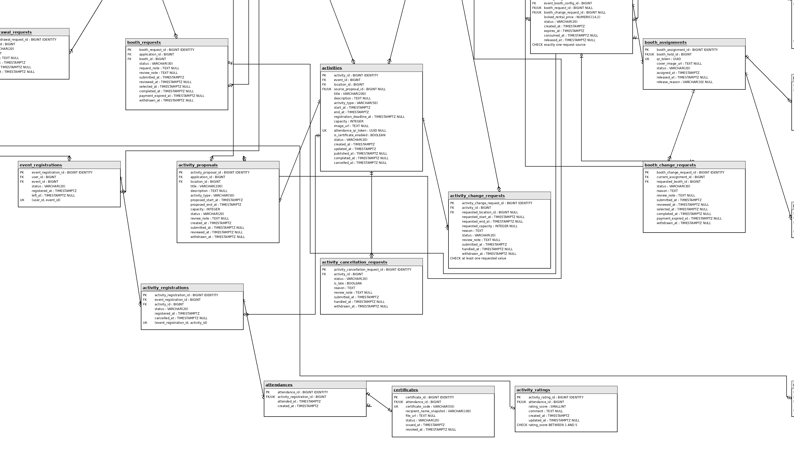
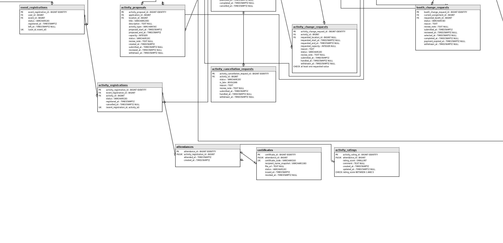
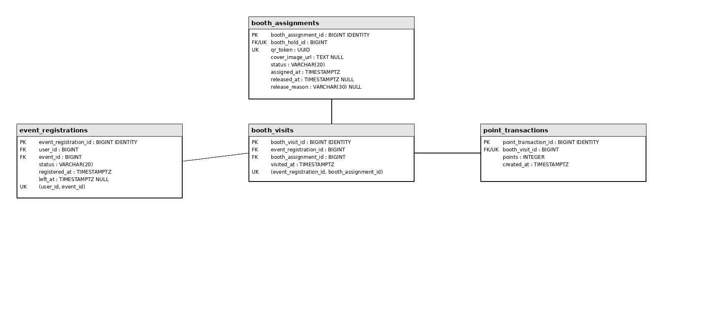
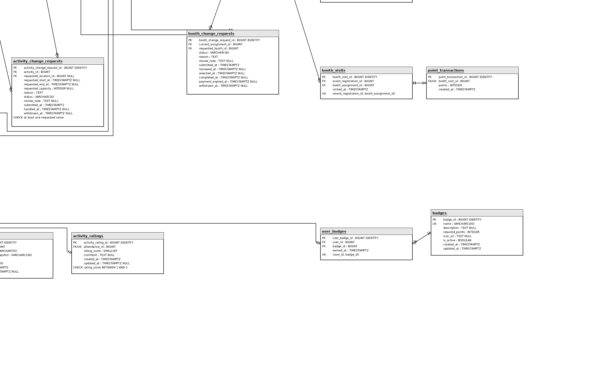
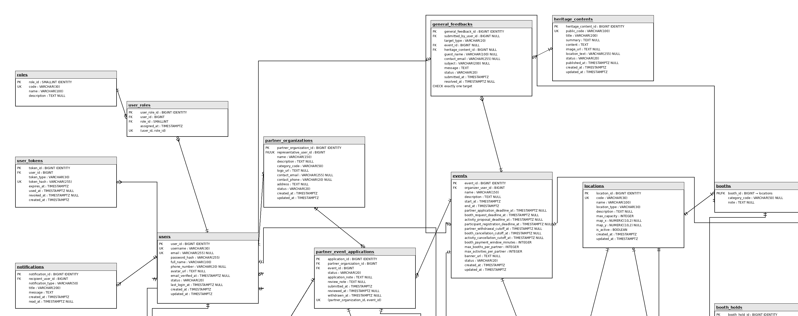

**BOOK STREET EVENT MANAGEMENT SYSTEM**

SWP391 \| V1–V18 implemented, updated 19 11 2026

**Mục đích tài liệu.** Tài liệu này mô tả schema đang chạy qua Flyway V18. Nguồn triển khai hiện
hành là chuỗi migration bất biến V1–V18. Mục 8–10, các overlay Sprint 8/Sprint 9/Sprint 11 và file nguồn
`BookStreet_Physical_ERD_v1.drawio` phản ánh phần Participant/Attendance đã được triển khai. File
drawio có target/reference 34 bảng; PNG tổng thể và PNG Participant/Attendance được export từ đúng
file nguồn này. Drawio/PNG chưa được tái xuất cho V18; đối với `users.sessions_valid_from` và
`admin_audit_logs`, migration V18, mục 4.1 của báo cáo này và Sprint 11 overlay là nguồn hiện hành.

**Kết luận chính.** Active schema qua V18 có 32 bảng. V10 thêm bảy bảng vật lý
`event_registrations`, `activity_registrations`, `attendances`, `attendance_adjustments`,
`certificates`, `activity_ratings`, `notifications`; bảng `activities` hiện hành đã có
`attendance_qr_token` và các cột cấu hình đăng ký/chứng nhận cần thiết. V11 thêm
`attendance_early_scan_minutes` cho cửa sổ quét theo từng Activity. V12 thêm bốn bảng
`booth_visits`, `point_transactions`, `badges`, `user_badges` và mở rộng `notifications` cho
`BADGE_UNLOCKED`. V13 thêm URL hình ảnh Booth. V14 thêm `general_feedbacks` với hai target đang
được hỗ trợ là `BOOK_STREET` và `EVENT`; V15 thêm `heritage_contents` độc lập với Feedback.
V16 và V17 mở rộng `notifications` theo role audience và không thêm bảng mới. V18 thêm
`users.sessions_valid_from` và bảng append-only `admin_audit_logs`.
Hai khái niệm Logical Change Request/Cancellation Request dùng chung một physical request table để
database enforce được đúng một request `PENDING` trên mỗi Activity. PostgreSQL là nguồn dữ liệu
chính; Redis chỉ giữ Session. Refund và đổi/hủy Booth sau Assignment vẫn là Post-MVP.

# Thông tin baseline

| **Hạng mục**     | **Nội dung**                               |
|------------------|--------------------------------------------|
| Database         | PostgreSQL                                 |
| Số bảng          | 32 implemented qua V18                     |
| Quy ước tên      | snake_case, tên bảng số nhiều              |
| Khóa chính       | BIGINT GENERATED BY DEFAULT AS IDENTITY    |
| Thời gian        | TIMESTAMPTZ                                |
| Tiền             | NUMERIC(14,2) và Java BigDecimal           |
| Session          | Spring Security Session lưu trong Redis    |
| File và hình ảnh | PostgreSQL chỉ lưu URL; backend dùng provider Cloudinary khi deploy và filesystem khi cấu hình local |

# Mục lục nội dung

- 1 Phạm vi và nguyên tắc thiết kế

- 2 Quy chuẩn Physical Database

- 3 Physical ERD tổng thể

- 4 Cụm Account và Authorization

- 5 Cụm Partner Event Location và Booth Config

- 6 Cụm Booth Allocation và Payment

- 7 Cụm Activity

- 8 Cụm Participant Attendance và Reward

- 9 Cụm Communication Feedback và Heritage

- 10 Constraint Index và Transaction quan trọng

- 11 Phân chia trách nhiệm PostgreSQL Spring Boot và Redis

- 12 Kết quả triển khai Sprint 6

- 13 Kết quả triển khai Sprint 7

- 14 Kết quả triển khai Sprint 8

- 15 Kết quả triển khai Sprint 9

- 16 Kết quả triển khai Sprint 10

- 17 Kết quả triển khai Sprint 11

- 18 Kết luận

# 1 Phạm vi và nguyên tắc thiết kế

Phần active overlay chuyển mô hình Logical MVP thành cấu trúc có thể triển khai trực tiếp trên
PostgreSQL. Target diagram còn chứa module tương lai để phục vụ thiết kế tổng thể; các entity đó
không tự động trở thành migration hiện hành. Ràng buộc đơn bảng đặt trong database; rule đọc nhiều
bảng được bảo vệ bằng Spring Boot transaction và row lock.

Thiết kế không thêm các bảng kỹ thuật không cần thiết. Không có bảng Participant riêng, Refund
riêng, BoothAvailability riêng, AttendanceOperator, AttendanceSession, NotificationType, JWT token
hoặc SystemSetting. `attendance_adjustments` là audit bắt buộc cho Organizer correction, không phải
Actor, Session hay workflow độc lập.

## Các nguyên tắc bắt buộc

- Không hard-delete dữ liệu đã phát sinh lịch sử công khai hoặc giao dịch; dùng status như
  DISABLED, CANCELLED, RELEASED hoặc ARCHIVED. Ngoại lệ duy nhất của Sprint 4 là xóa Event còn
  `DRAFT` cùng cấu hình Event-scoped khi chưa có dependency nghiệp vụ.

- Mỗi initial-rental payment attempt là một BoothPayment riêng; không overwrite lịch sử cũ. Refund
  attempt chỉ là Post-MVP reference dù V7 đã có cột extension.

- Giá đang giao dịch được snapshot vào BoothHold và BoothPayment, không thay đổi theo cấu hình giá sau đó.

- Booth availability được suy ra từ EventBoothConfig, Active Hold và Active Assignment, không lưu thành một cột trạng thái cố định.

- Activity chỉ liên kết Location; Booth là subtype của Location và không tạo thêm quan hệ Activity với Booth.

- Activity QR và Booth QR chỉ nhận diện đối tượng được quét; User được xác định từ Session đăng nhập.

## Implemented Sprint 4 schema

V8 đã mở rộng hai bảng active:

- `events`: thêm nullable `cancelled_at`, `cancellation_reason` và CHECK để hai giá trị chỉ tồn tại
  nhất quán với status `CANCELLED`;
- `booth_requests`: thêm status `CANCELLED`, nullable `cancelled_at` và CHECK trạng thái/thời điểm.

Vì V3 đã cho phép `events.status = 'CANCELLED'` trước khi có metadata, V8 phải upgrade được dữ liệu
cũ: trước khi thêm CHECK, mọi Event `CANCELLED` thiếu metadata được backfill
`cancelled_at = updated_at` và `cancellation_reason = 'Sự kiện đã được hủy trước khi hệ thống lưu lý do.'`.
Sau backfill, Event `CANCELLED` bắt buộc có cả hai trường; status khác bắt buộc cả hai là null.
V6 chưa cho phép BoothRequest `CANCELLED`, nên không có legacy BoothRequest cần backfill.

V8 không tạo `booth_change_requests`, `booth_cancellation_requests` hoặc
`partner_withdrawal_requests`. Event cancellation release `booth_holds` hiện có; Partner release
trước settlement dùng trạng thái `WITHDRAWN`/`RELEASED` hiện có. V1–V8 là baseline migration bất
biến hiện hành.

## Implemented Sprint 5 V9 schema

V9 đã được merge và là baseline bất biến hiện hành:

- chuẩn hóa/check type và uniqueness của `locations`;
- tạo `activity_proposals`, `activities`, `activity_requests`, `activity_revisions`;
- bật extension `btree_gist` và exclusion constraint lịch Location;
- dùng một physical request table với `request_type=CHANGE|CANCELLATION`;
- thêm partial unique index để chỉ một request `PENDING` tồn tại trên mỗi Activity;
- giữ V1–V8 bất biến và không tạo các bảng Participant/Notification trong Sprint 5.

## Implemented Sprint 6 V10/V11 schema

Sprint 6 giữ V1–V9 bất biến. V10 thêm bảy bảng Participant, kích hoạt Notification bền vững và
không tạo Event QR, QR riêng theo Participant, Attendance Operator, waitlist hoặc generic broadcast
module. V11 bổ sung cấu hình cửa sổ quét sớm theo Activity. Active schema tăng từ 18 lên 25 bảng;
target/reference diagram đầy đủ tăng từ 33 lên 34 bảng vì thêm `attendance_adjustments` vào mô hình
cũ.

## Implemented Sprint 7 V12 schema

V12 giữ V1–V11 bất biến và kích hoạt bốn bảng Reward đã được mô hình hóa trong target ERD:

- `booth_visits` lưu một lượt ghé duy nhất theo EventRegistration và BoothAssignment;
- `point_transactions` lưu một ledger fact dương, bất biến cho mỗi BoothVisit;
- `badges` lưu danh mục Badge toàn cục với tên chuẩn hóa, ngưỡng điểm dương và trạng thái active;
- `user_badges` lưu lịch sử Badge một User đã đạt, không bị thu hồi khi rule thay đổi;
- `notifications.badge_id` và các CHECK được mở rộng đúng một nhánh `BADGE_UNLOCKED`, không làm yếu
  năm loại Notification Sprint 6.

Active schema tăng từ 25 lên 29 bảng. Tổng điểm tiếp tục được suy ra từ ledger; V12 không thêm
`users.total_points`, job table, generic settings, Event QR hoặc Participant-specific QR.

# 2 Quy chuẩn Physical Database

| **Loại**          | **Quy chuẩn**      | **Lý do**                                                               |
|-------------------|--------------------|-------------------------------------------------------------------------|
| Tên               | snake_case         | Phù hợp PostgreSQL và dễ ánh xạ JPA.                                    |
| Primary Key       | BIGINT IDENTITY    | Đủ lớn, ổn định và dễ sử dụng trong Spring Data JPA.                    |
| Timestamp         | TIMESTAMPTZ        | Lưu thời điểm có múi giờ; backend lưu UTC và hiển thị Asia Ho Chi Minh. |
| Money             | NUMERIC(14,2)      | Tránh sai số của FLOAT hoặc DOUBLE.                                     |
| Status            | VARCHAR + CHECK    | An toàn nhưng dễ migration hơn PostgreSQL native ENUM.                  |
| QR và idempotency | UUID               | Khó đoán và phù hợp token công khai.                                    |
| Nội dung dài      | TEXT               | Dùng cho mô tả, ghi chú và nội dung Heritage.                           |
| Xóa dữ liệu       | ON DELETE RESTRICT | Giữ lịch sử nghiệp vụ và audit.                                         |

# 3 Physical ERD tổng thể

File nguồn Draw.io và PNG tổng thể hiện có target topology 34 bảng, bao gồm
`attendance_adjustments`, các cột/status Sprint 6 và trang chi tiết
`04 - Participant & Attendance`. Do mật độ lớn, các phần sau sử dụng hình phóng to theo từng cụm để
đọc datatype, PK, FK và UK rõ hơn. Những ảnh cụm cũ chưa được tái xuất vẫn được ghi rõ là legacy ở
caption tương ứng. Với schema qua V17, file drawio và các mục 8–10 có ưu tiên khi có khác biệt; riêng
hai bổ sung V18 dùng migration, mục 4.1 và Sprint 11 overlay vì sơ đồ chưa được tái xuất.



*Hình 1 Physical ERD target 34 bảng, đã export lại sau Sprint 6 overlay review*

# 4 Cụm Account và Authorization

Cụm Account quản lý danh tính đăng nhập và quyền truy cập. Participant có thể đăng ký bằng username và password mà không cần email. Partner, Organizer và Admin phải có email đã xác minh trước khi được cấp role tương ứng.


*Hình 2 Cụm Account Authorization và các quan hệ tới User*

| **Bảng**    | **Trách nhiệm**                                                           | **Ràng buộc chính**                                                                     |
|-------------|---------------------------------------------------------------------------|-----------------------------------------------------------------------------------------|
| users       | Lưu tài khoản, username, password hash, thông tin hiển thị, trạng thái và mốc hiệu lực Session. | Username unique không phân biệt hoa thường. Email nullable nhưng unique khi có giá trị. `sessions_valid_from` nullable. |
| roles       | Danh mục role hệ thống.                                                   | Code unique: PARTICIPANT, PARTNER, ORGANIZER, ADMIN.                                    |
| user_roles  | Giải quan hệ nhiều nhiều giữa User và Role.                               | PK user_role_id và UNIQUE(user_id, role_id).                                            |
| user_tokens | Token xác minh email và đặt lại mật khẩu.                                 | Chỉ lưu token_hash; có expires_at, used_at và revoked_at.                               |

confirmPassword chỉ tồn tại ở React để kiểm tra hai lần nhập mật khẩu và không được lưu trong database. Password phải được băm bằng BCrypt hoặc cơ chế tương đương của Spring Security; tuyệt đối không lưu plaintext.

## 4.1 Audit quản trị Sprint 11

V18 thêm `users.sessions_valid_from TIMESTAMPTZ NULL`. Khi tài khoản bị khóa hoặc đặt lại mật khẩu
thành công, backend cập nhật mốc này; Session đăng nhập trước mốc không còn hợp lệ. Mở khóa không
xóa mốc nên Session cũ không tự hoạt động trở lại.

V18 cũng tạo `admin_audit_logs`:

| **Cột** | **Kiểu** | **Ý nghĩa** |
|---|---|---|
| audit_log_id | BIGINT IDENTITY PK | Định danh log ổn định |
| actor_user_id | BIGINT NOT NULL FK users | Admin thực hiện; `ON DELETE RESTRICT` |
| action | VARCHAR(40) NOT NULL | Action thuộc tập đóng của Sprint 11 |
| target_type | VARCHAR(30) NOT NULL | `USER`, `PARTNER_ORGANIZATION` hoặc `BADGE` |
| target_id | BIGINT NOT NULL | ID đa hình, không đặt FK |
| target_label | VARCHAR(200) NOT NULL | Nhãn tại thời điểm thao tác |
| reason | VARCHAR(500) NULL | Bắt buộc 10–500 ký tự cho lock/unlock; null cho action khác |
| details | JSONB NOT NULL | Object chứa dữ kiện nhỏ, không chứa secret |
| created_at | TIMESTAMPTZ NOT NULL | Thời điểm backend ghi thay đổi |

CHECK liên kết đúng `action` với `target_type`, kiểm tra target dương/nhãn không rỗng, `details` là
JSON object và rule reason. Ứng dụng không có update/delete API cho bảng này. Thay đổi quản trị và
audit row phải commit trong cùng transaction.

# 5 Cụm Partner Event Location và Booth Config

Cụm này mô tả tổ chức Partner, việc tham gia Event, không gian vật lý và cấu hình Booth theo từng Event. Giá Booth không nằm trên bảng booths vì cùng Booth vật lý có thể có giá khác nhau giữa các Event.


*Hình 3 Cụm Partner Event Location Booth và EventBoothConfig*

| **Bảng**                   | **Trách nhiệm**                                             | **Ràng buộc chính**                                                                                |
|----------------------------|-------------------------------------------------------------|----------------------------------------------------------------------------------------------------|
| partner_organizations      | Hồ sơ tổ chức Partner và tài khoản đại diện.                | representative_user_id unique trong phạm vi MVP.                                                   |
| partner_event_applications | Đơn Partner xin tham gia một Event.                         | UNIQUE(partner_organization_id, event_id); phải APPROVED trước BoothRequest hoặc ActivityProposal. |
| events                     | Thông tin Event, deadline, cutoff, payment window và quota. | end_at lớn hơn start_at; các quota và payment window không âm.                                     |
| locations                  | Địa điểm vật lý dùng chung.                                 | Code unique; max_capacity dương; location_type phân biệt BOOTH và khu Activity.                    |
| booths                     | Subtype của Location dành cho nghiệp vụ Booth.              | booth_id vừa là PK vừa là FK tới locations.                                                        |
| event_booth_configs        | Mở một Booth trong Event với giá và cờ is_enabled.          | UNIQUE(event_id, booth_id); không disable khi có Active Hold hoặc Assignment.                      |

is_enabled chỉ có nghĩa Booth có được mở trong Event hay không. AVAILABLE, ON_HOLD và ASSIGNED là trạng thái runtime được suy ra từ Hold và Assignment; không dùng is_enabled thay cho availability.

# 6 Cụm Booth Allocation và Payment

Đây là cụm quan trọng nhất của MVP. Nhiều Partner có thể request cùng Booth. Submit request chưa khóa Booth; chỉ khi Organizer chọn candidate thì hệ thống mới tạo Hold, khóa giá và mở payment window.


*Hình 4 Target diagram; Change/Cancellation request tables là Post-MVP*

| **Bảng**                    | **Trách nhiệm**                                             | **Ràng buộc chính**                                                                      |
|-----------------------------|-------------------------------------------------------------|------------------------------------------------------------------------------------------|
| booth_requests              | Yêu cầu Booth ban đầu của Partner.                          | PENDING đến SELECTED rồi COMPLETED; candidate khác chỉ NOT_SELECTED sau payment success. |
| booth_holds                 | Giữ Booth sau khi Organizer chọn candidate và snapshot giá. | Đúng một nguồn request; tối đa một Active Hold cho EventBoothConfig.                     |
| booth_payments              | Active MVP lưu initial-rental payment attempt.              | Idempotency key unique; không overwrite retry; REFUND columns là extension Post-MVP.     |
| booth_assignments           | Cấp Booth chính thức sau settlement hợp lệ.                 | Một Hold tối đa một Assignment; qr_token unique.                                         |
| booth_change_requests       | POST-MVP REFERENCE, chưa có trong active schema.            | Không tạo trong Sprint 4.                                                                |
| booth_cancellation_requests | POST-MVP REFERENCE, chưa có trong active schema.            | Không tạo trong Sprint 4.                                                                |
| partner_withdrawal_requests | POST-MVP REFERENCE, chưa có trong active schema.            | Không tạo trong Sprint 4.                                                                |

## 6.1 Payment retry và payment window

V7 adds the approved provider/reconciliation columns to `booth_payments`:
`checkout_url`, `checkout_expires_at`, `provider_response_code`,
`provider_transaction_status`, `last_gateway_query_at`,
`trusted_incomplete_query_count`, `reconciliation_required` and
`reconciliation_detail`. The stable initial-rental purpose is
`INITIAL_BOOTH_RENTAL`. `vnp_TxnRef` is derived as `BSP{booth_payment_id}` and is therefore not
stored separately.

- A zero-price Booth creates no BoothPayment. Organizer selection creates the Hold, immediately
  consumes it and creates the Assignment atomically. A positive configured price below 5,000 VND
  is invalid.

- Mỗi retry tạo một BoothPayment mới với idempotency_key mới; attempt cũ được giữ nguyên.

- Với VNPay PAY, BoothPayment mới và toàn bộ checkout metadata (`checkout_url`,
  `checkout_expires_at`) được commit nguyên tử sau khi ký URL cục bộ. Vì không có remote
  session-creation call, hệ thống không để lại một Payment `PENDING` nhìn thấy được nhưng thiếu URL.
  Row cũ/bất thường thiếu checkout metadata sau grace period được đóng `FAILED` với
  `CHECKOUT_NOT_CREATED` để Hold đủ điều kiện có thể retry an toàn.

- FAILED hoặc TIMEOUT của một attempt không giải phóng Hold nếu expires_at chưa đến.

- Scheduled job chỉ chuyển Hold thành EXPIRED khi payment window thực sự hết hạn và không còn BoothPayment `PENDING` cần đối soát.

- Nếu `expires_at` đã qua nhưng còn Payment `PENDING`, Hold tạm giữ `ACTIVE`, request nguồn giữ `SELECTED` và Booth vẫn được suy ra là `ON_HOLD`. `expires_at` chặn mọi payment attempt mới; nó không cho phép release/reassign khi kết quả giao dịch cũ chưa rõ.

- Qua V7, reconciliation claim lượt QueryDR trong một transaction ngắn bằng lock `Hold → Payment`
  và ghi `last_gateway_query_at`, sau đó mới nhả lock và gọi gateway ngoài DB transaction. Khi triển
  khai Sprint 4, mỗi transaction ngắn này phải khóa Event trước rồi giữ thứ tự `Hold → Payment` bên
  trong; gateway I/O vẫn nằm ngoài transaction. Cơ chế claim chặn nhiều worker gọi trùng trong
  minimum query interval. SUCCESS consume Hold và tạo Assignment; FAILED hoặc TIMEOUT expire Hold
  nếu `expires_at` đã qua; kết quả chưa rõ giữ nguyên Hold và Payment để không cấp Booth trùng.

- Mọi truy vấn availability và selection phải coi một row Hold `ACTIVE` là đang khóa Booth kể cả khi `expires_at` đã qua. Chỉ expiry/reconciliation service mới được chuyển row đó sang `EXPIRED`; partial unique index hiện có tiếp tục là lớp bảo vệ cuối cùng.

- Payment SUCCESS được backend xác minh trước khi tạo BoothAssignment.

## 6.2 Refund bất đồng bộ — POST-MVP REFERENCE

Khi Organizer duyệt cancellation hoặc withdrawal đủ điều kiện, database tạo BoothPayment REFUND với trạng thái PENDING và hoàn tất thay đổi nghiệp vụ. Hệ thống không giữ Assignment hoặc Change Request ở trạng thái chờ chỉ vì ngân hàng chưa xử lý refund.



*Hình 5 Nguồn nghiệp vụ của refund transaction*

Nếu refund attempt thất bại, lần retry tạo record mới. Trước khi retry, Spring Boot khóa Payment gốc và kiểm tra tổng refund PENDING cộng SUCCESS không vượt số tiền được hoàn.

## 6.3 Đổi Booth — POST-MVP REFERENCE

| **So sánh giá**  | **Điều kiện swap**                    | **Kết quả**                                       |
|------------------|---------------------------------------|---------------------------------------------------|
| Giá mới cao hơn  | Payment phần chênh lệch phải SUCCESS. | Assignment cũ REPLACED; Assignment mới ACTIVE.    |
| Giá bằng nhau    | Không cần transaction tiền.           | Atomic swap ngay sau khi duyệt và kiểm tra Booth. |
| Giá mới thấp hơn | Tạo REFUND PENDING thành công.        | Swap không chờ ngân hàng hoàn tiền.               |

# 7 Cụm Activity

Activity không có payment. Proposal chỉ là đề xuất và chưa khóa Location. Khi Proposal được duyệt
hoặc Organizer tạo Activity trực tiếp, Activity `DRAFT` mới tham gia kiểm tra xung đột. Sprint 5
dùng overlay dưới đây thay cho các cột/status Activity trên hình target v1.



*Hình 6 Cụm Activity Proposal Activity Change và Cancellation*

| **Bảng**             | **Trách nhiệm**                              | **Ràng buộc chính**                                                                                 |
|----------------------|----------------------------------------------|-----------------------------------------------------------------------------------------------------|
| activity_proposals   | Đề xuất Activity của Partner.                | Application APPROVED; sáu status; Proposal mở không khóa Location; submitted_at/updated_at bắt buộc. |
| activities           | Activity chính thức thuộc Event và Location. | source proposal unique; năm status; cancellation/registration consistency; exclusion lịch.          |
| activity_requests    | Physical table chung cho Change/Cancel.      | request_type CHECK; đúng một PENDING/Activity bằng partial unique index.                              |
| activity_revisions   | Audit bất biến cho thay đổi đã áp dụng.      | Actor/source + old/new JSONB snapshot; không update/delete qua API.                                   |

## 7.1 Mở rộng `locations`

V9 giữ nguyên PK/FK hiện có và thêm/siết:

- `location_type IN ('BOOTH','STAGE','WORKSHOP','AREA')`;
- code được migration/service normalize `UPPER(BTRIM(code))` và CHECK pattern
  `^[A-Z0-9_-]{1,30}$`;
- functional unique index trên `UPPER(BTRIM(code))` để uniqueness không phụ thuộc hoa thường;
- `map_x`, `map_y` nếu có nằm trong 0–100 với tối đa hai chữ số thập phân;
- generic Location API không tạo `BOOTH`; subtype đó vẫn do `booths` quản lý;
- service chặn deactivate hoặc hạ max capacity khi Activity không Cancelled đang áp dụng.

## 7.2 Bảng `activity_proposals`

| Cột | Kiểu/null | Ghi chú |
|---|---|---|
| activity_proposal_id | BIGINT IDENTITY PK | ID |
| application_id | BIGINT NOT NULL FK | `partner_event_applications`, ON DELETE RESTRICT |
| location_id | BIGINT NOT NULL FK | `locations`, ON DELETE RESTRICT |
| title | VARCHAR(200) NOT NULL | BTRIM không rỗng |
| description | TEXT NULL | service max 5.000 |
| activity_type | VARCHAR(50) NOT NULL | BTRIM không rỗng |
| proposed_start_at | TIMESTAMPTZ NOT NULL | nhỏ hơn end |
| proposed_end_at | TIMESTAMPTZ NOT NULL | lớn hơn start |
| capacity | INTEGER NOT NULL | > 0 |
| status | VARCHAR(20) NOT NULL | PENDING/NEED_CHANGES/APPROVED/REJECTED/WITHDRAWN/CANCELLED |
| review_note | TEXT NULL | cần cho NEED_CHANGES/REJECTED |
| submitted_at | TIMESTAMPTZ NOT NULL | create submit ngay |
| updated_at | TIMESTAMPTZ NOT NULL | mọi edit/resubmit |
| reviewed_at | TIMESTAMPTZ NULL | review decision/request changes |
| withdrawn_at | TIMESTAMPTZ NULL | chỉ WITHDRAWN |
| cancelled_at | TIMESTAMPTZ NULL | chỉ CANCELLED |

CHECK giữ `withdrawn_at`/`cancelled_at` nhất quán với status; `APPROVED`/`REJECTED` có
`reviewed_at`; NEED_CHANGES có review metadata. Index ưu tiên `(application_id, submitted_at DESC)`,
`(status, submitted_at)` và `location_id`.

## 7.3 Bảng `activities`

| Cột | Kiểu/null | Ghi chú |
|---|---|---|
| activity_id | BIGINT IDENTITY PK | ID |
| event_id | BIGINT NOT NULL FK | `events`, ON DELETE RESTRICT |
| location_id | BIGINT NOT NULL FK | `locations`, ON DELETE RESTRICT |
| source_proposal_id | BIGINT NULL FK UNIQUE | null với BTC Activity; một Proposal tối đa một Activity |
| title | VARCHAR(200) NOT NULL | BTRIM không rỗng |
| description | TEXT NULL | service max 5.000 |
| activity_type | VARCHAR(50) NOT NULL | BTRIM không rỗng |
| start_at/end_at | TIMESTAMPTZ NOT NULL | CHECK end > start |
| registration_required | BOOLEAN NOT NULL DEFAULT FALSE | quyết định Participant registration |
| registration_deadline_at | TIMESTAMPTZ NULL | chỉ khi registration required; <= start_at |
| capacity | INTEGER NOT NULL | > 0, service <= Location capacity |
| image_url | TEXT NULL | HTTP(S), max 2.048 ở service |
| attendance_qr_token | UUID NULL UNIQUE | chỉ tạo một lần khi publish + registration required |
| attendance_early_scan_minutes | INTEGER NOT NULL DEFAULT 15 | V11; CHECK 0–1440; mở quét trước giờ bắt đầu Activity |
| is_certificate_enabled | BOOLEAN NOT NULL DEFAULT FALSE | chỉ true khi registration required |
| status | VARCHAR(20) NOT NULL | DRAFT/PUBLISHED/ONGOING/COMPLETED/CANCELLED |
| created_at/updated_at | TIMESTAMPTZ NOT NULL | audit |
| published_at | TIMESTAMPTZ NULL | non-null sau first publish |
| completed_at | TIMESTAMPTZ NULL | chỉ COMPLETED |
| cancelled_at | TIMESTAMPTZ NULL | chỉ CANCELLED |
| cancellation_reason | TEXT NULL | 10–500 khi Cancelled |
| cancellation_source | VARCHAR(30) NULL | ORGANIZER/PARTNER_REQUEST/EVENT_CANCELLATION/SYSTEM |

CHECK chính:

- registration false → deadline/token null và certificate false;
- registration true → deadline có thể null khi chưa từng publish; nếu `published_at` non-null thì
  deadline/token đều non-null và deadline không sau start;
- PUBLISHED/ONGOING/COMPLETED bắt buộc `published_at` non-null; DRAFT bắt buộc null; CANCELLED giữ
  `published_at` nếu từng public và được phép null nếu bị hủy từ Draft;
- cancellation timestamp/reason/source cùng null hoặc cùng có và chỉ có ở `CANCELLED`;
- `completed_at` chỉ có ở `COMPLETED`;
- `published_at` giữ lại khi Activity từng public rồi bị Cancelled.

V9 bật `btree_gist` và tạo exclusion constraint:

```sql
EXCLUDE USING gist (
    location_id WITH =,
    tstzrange(start_at, end_at, '[)') WITH &&
)
WHERE (status <> 'CANCELLED')
```

Constraint áp dụng cả Draft và across Event. Vi phạm phải được backend map thành
`409 ACTIVITY_LOCATION_TIME_CONFLICT`.

Baseline Sprint 6 V10 không thêm cột mới vào `activities`. Yêu cầu cấu hình cửa sổ QR bổ sung V11 `attendance_early_scan_minutes`. Các cột `registration_required`,
`registration_deadline_at`, `capacity`, `attendance_qr_token` và `is_certificate_enabled` của V9
được sử dụng lại. Freeze schedule/Location sau Attendance `VALID`, capacity floor theo seat-active
count và cửa sổ scan là cross-table rule do service kiểm tra dưới Event/Activity lock; không thể
biểu diễn đúng bằng CHECK đơn bảng. Một schedule/Location change hợp lệ trước Attendance không
update identity/status của `activity_registrations`; service chỉ tính lại overlap warning và ghi
Notification cho seat-active recipient trong cùng transaction với ActivityRevision/change.

## 7.4 Bảng vật lý chung `activity_requests`

Logical/API vẫn gọi ActivityChangeRequest và ActivityCancellationRequest. Physical dùng một bảng
để database enforce invariant cross-type.

| Cột | Kiểu/null | Ghi chú |
|---|---|---|
| activity_request_id | BIGINT IDENTITY PK | API alias thành change/cancellation request ID |
| activity_id | BIGINT NOT NULL FK | `activities`, ON DELETE RESTRICT |
| request_type | VARCHAR(20) NOT NULL | CHANGE hoặc CANCELLATION |
| requested_location_id | BIGINT NULL FK | chỉ CHANGE |
| requested_title | VARCHAR(200) NULL | chỉ CHANGE |
| requested_description | TEXT NULL | chỉ CHANGE; đi cùng cờ present để phân biệt clear/null |
| requested_description_present | BOOLEAN NOT NULL DEFAULT FALSE | lưu explicit null/clear khác omitted |
| requested_activity_type | VARCHAR(50) NULL | chỉ CHANGE |
| requested_start_at/end_at | TIMESTAMPTZ NULL | phải cùng null hoặc cùng có; chỉ CHANGE |
| requested_capacity | INTEGER NULL | > 0 nếu có; chỉ CHANGE |
| requested_image_url | TEXT NULL | chỉ CHANGE; đi cùng cờ present |
| requested_image_url_present | BOOLEAN NOT NULL DEFAULT FALSE | lưu explicit null/clear khác omitted |
| reason | TEXT NOT NULL | normalize 10–500 |
| is_late | BOOLEAN NOT NULL DEFAULT FALSE | chỉ CANCELLATION có thể true |
| status | VARCHAR(20) NOT NULL | PENDING/APPROVED/REJECTED/WITHDRAWN/CANCELLED |
| review_note | TEXT NULL | reject note/audit |
| submitted_at | TIMESTAMPTZ NOT NULL | audit |
| handled_at | TIMESTAMPTZ NULL | APPROVED/REJECTED |
| withdrawn_at | TIMESTAMPTZ NULL | WITHDRAWN |
| cancelled_at | TIMESTAMPTZ NULL | system close |

CHECK theo `request_type`:

- CHANGE: ít nhất một requested field có giá trị hoặc một presence flag true, `is_late=false`;
- CANCELLATION: mọi requested field null, hai presence flag false, chỉ reason + late flag;
- timestamps nhất quán với terminal status;
- cặp requested start/end nhất quán và end > start khi có.

Partial unique index bắt buộc:

```sql
CREATE UNIQUE INDEX uk_activity_requests_one_pending
    ON activity_requests(activity_id)
    WHERE status = 'PENDING';
```

Service vẫn khóa Activity và check sớm để trả lỗi thân thiện; unique violation trong race map thành
`409 ACTIVITY_REQUEST_ALREADY_PENDING`.

## 7.5 Bảng kỹ thuật `activity_revisions`

Bảng này giải quyết yêu cầu “reschedule/move là audited change” mà không tạo status
`RESCHEDULED`. Đây là audit kỹ thuật, không phải request workflow mới.

| Cột | Kiểu/null | Ghi chú |
|---|---|---|
| activity_revision_id | BIGINT IDENTITY PK | ID |
| activity_id | BIGINT NOT NULL FK | `activities`, ON DELETE RESTRICT |
| actor_user_id | BIGINT NULL FK | null cho SYSTEM lifecycle/cascade |
| source_request_id | BIGINT NULL FK | `activity_requests` khi approve Partner change |
| revision_source | VARCHAR(30) NOT NULL | ORGANIZER_DIRECT/PARTNER_REQUEST/EVENT_CANCELLATION/SYSTEM |
| change_reason | TEXT NULL | bắt buộc cho Organizer đổi core field của Published Activity |
| old_snapshot | JSONB NOT NULL | immutable business/config fields trước thay đổi |
| new_snapshot | JSONB NOT NULL | immutable business/config fields sau thay đổi |
| changed_at | TIMESTAMPTZ NOT NULL | backend time |

Snapshot chỉ chứa field nghiệp vụ Activity, không chứa Session, CSRF, secret hay dữ liệu cá nhân.
Database CHECK yêu cầu `jsonb_typeof(old_snapshot) = 'object'` và tương tự cho new snapshot.
Applied core/config change và mọi cancellation ghi revision; publish/ONGOING/COMPLETED đã có
timestamp lifecycle riêng nên không bắt buộc tạo revision. Service không cung cấp
create/update/delete trực tiếp cho revision. Index ưu tiên
`(activity_id, changed_at, activity_revision_id)`; request approval ghi Activity + revision trong
cùng transaction. Organizer/Partner chỉ đọc lịch sử trong phạm vi ownership tương ứng.

# 8 Cụm Participant Attendance và Reward

Participant không phải bảng riêng. Một User trở thành Participant của Event thông qua
EventRegistration. Từ đó User đăng ký Activity và tự quét QR dùng chung của Activity để tạo
Attendance. Sprint 6 thêm audit `attendance_adjustments`; không tạo QR riêng cho Participant và
không có Attendance Operator.



*Hình 7 cụm Participant/Attendance đã cập nhật status/source, correction audit và Notification reference*

| **Bảng**               | **Trách nhiệm**                                      | **Ràng buộc chính**                                                                                  |
|------------------------|------------------------------------------------------|------------------------------------------------------------------------------------------------------|
| event_registrations    | Một User tham gia một Event.                          | UNIQUE(user_id, event_id); tái tham gia dùng lại row.                                                |
| activity_registrations | Một seat của Participant trong Activity.              | UNIQUE(event_registration_id, activity_id); status/source/timestamps nhất quán.                       |
| attendances            | Bằng chứng tham dự hiệu lực hoặc đã bị void.          | UNIQUE(activity_registration_id); scan lặp không tạo row mới.                                        |
| attendance_adjustments | Audit append-only cho Organizer correction.           | Idempotency key unique; lưu previous/new state snapshot, actor, reason và effective time.             |
| activity_ratings       | Đánh giá của người có Attendance hợp lệ.              | UNIQUE(attendance_id); score 1–5; giữ row ở INVALIDATED khi Attendance bị void.                       |
| certificates           | Chứng nhận sau khi Activity hoàn tất.                 | UNIQUE(attendance_id), code unique; revoke/reissue dùng lại identity/code.                            |

## 8.1 Bảng `event_registrations`

| Cột | Kiểu/null | Ghi chú |
|---|---|---|
| event_registration_id | BIGINT IDENTITY PK | ID bền vững qua Join/Leave/rejoin |
| user_id | BIGINT NOT NULL FK | `users`, ON DELETE RESTRICT |
| event_id | BIGINT NOT NULL FK | `events`, ON DELETE RESTRICT |
| status | VARCHAR(20) NOT NULL | ACTIVE/LEFT |
| registered_at | TIMESTAMPTZ NOT NULL | lần Join đầu tiên, không rewrite |
| activated_at | TIMESTAMPTZ NOT NULL | lần Join/rejoin thành công gần nhất |
| left_at | TIMESTAMPTZ NULL | chỉ có khi LEFT |
| updated_at | TIMESTAMPTZ NOT NULL | lần transition gần nhất |

Constraint bắt buộc:

- UNIQUE `(user_id, event_id)`;
- `ACTIVE` yêu cầu `left_at IS NULL`; `LEFT` yêu cầu `left_at IS NOT NULL`;
- `registered_at <= activated_at <= updated_at`; nếu `left_at` có giá trị thì
  `activated_at <= left_at <= updated_at`;
- rejoin update cùng row, đặt status `ACTIVE`, cập nhật `activated_at`/`updated_at` và clear
  `left_at`; không thay `registered_at`.

## 8.2 Bảng `activity_registrations`

| Cột | Kiểu/null | Ghi chú |
|---|---|---|
| activity_registration_id | BIGINT IDENTITY PK | ID |
| event_registration_id | BIGINT NOT NULL FK | `event_registrations`, ON DELETE RESTRICT |
| activity_id | BIGINT NOT NULL FK | `activities`, ON DELETE RESTRICT |
| status | VARCHAR(20) NOT NULL | ACTIVE/CANCELLED/NO_SHOW |
| cancellation_source | VARCHAR(20) NULL | PARTICIPANT/ACTIVITY/EVENT; chỉ CANCELLED |
| registered_at | TIMESTAMPTZ NOT NULL | lần đăng ký đầu tiên, không rewrite |
| activated_at | TIMESTAMPTZ NOT NULL | lần đăng ký/re-register thành công gần nhất |
| cancelled_at | TIMESTAMPTZ NULL | chỉ CANCELLED |
| no_show_at | TIMESTAMPTZ NULL | chỉ NO_SHOW, do completion finalization/correction |
| updated_at | TIMESTAMPTZ NOT NULL | audit transition |

Constraint bắt buộc:

- UNIQUE `(event_registration_id, activity_id)`;
- `ACTIVE`: `cancellation_source`, `cancelled_at`, `no_show_at` đều null;
- `CANCELLED`: source và `cancelled_at` non-null, `no_show_at` null;
- `NO_SHOW`: source và `cancelled_at` null, `no_show_at` non-null;
- `registered_at <= activated_at <= updated_at`; terminal timestamp nếu có không trước
  `activated_at` và không sau `updated_at`;
- database không lưu `ATTENDED`; service suy ra từ Attendance `VALID`;
- capacity đếm seat-active theo Activity status như BR-93, không đếm mọi row `ACTIVE` lịch sử của
  Activity đã `COMPLETED`;
- service bắt buộc xác nhận `event_registrations.event_id = activities.event_id` dưới Event/Activity
  lock trước insert/reactivate; hai FK đơn lẻ không tự enforce được invariant cross-table này.

## 8.3 Bảng `attendances`

| Cột | Kiểu/null | Ghi chú |
|---|---|---|
| attendance_id | BIGINT IDENTITY PK | ID |
| activity_registration_id | BIGINT NOT NULL FK UNIQUE | `activity_registrations`, ON DELETE RESTRICT |
| status | VARCHAR(20) NOT NULL | VALID/VOIDED |
| recorded_source | VARCHAR(30) NOT NULL | SELF_SCAN/ORGANIZER_CORRECTION |
| attended_at | TIMESTAMPTZ NOT NULL | thời gian tham dự hiệu lực, phải nằm trong scan window |
| created_at | TIMESTAMPTZ NOT NULL | lúc record được tạo; có thể khác attended_at khi correction |
| updated_at | TIMESTAMPTZ NOT NULL | lần thay đổi validity gần nhất |
| voided_at | TIMESTAMPTZ NULL | chỉ VOIDED |

Constraint đơn bảng yêu cầu `VALID -> voided_at IS NULL`, `VOIDED -> voided_at IS NOT NULL`,
`created_at <= updated_at` và `voided_at <= updated_at` khi có. Cửa sổ
`[activity.start_at - 15 phút, activity.end_at)` là cross-table service rule dưới Activity lock.
Participant identity đi qua ActivityRegistration/EventRegistration và Session, không lưu thêm
`user_id` do scan client gửi.

## 8.4 Bảng audit `attendance_adjustments`

| Cột | Kiểu/null | Ghi chú |
|---|---|---|
| attendance_adjustment_id | BIGINT IDENTITY PK | ID append-only |
| activity_registration_id | BIGINT NOT NULL FK | `activity_registrations`, ON DELETE RESTRICT |
| actor_user_id | BIGINT NOT NULL FK | Organizer thực hiện, `users`, ON DELETE RESTRICT |
| idempotency_key | UUID NOT NULL UNIQUE | exact retry trả cùng correction, không append trùng |
| previous_state | JSONB NOT NULL | snapshot registration/cancellation/Attendance trước correction |
| new_state | JSONB NOT NULL | snapshot registration/cancellation/Attendance sau correction |
| effective_attended_at | TIMESTAMPTZ NULL | effective time dùng khi tạo/restore VALID Attendance |
| reason | VARCHAR(500) NOT NULL | normalized 10–500 ký tự |
| adjusted_at | TIMESTAMPTZ NOT NULL | backend processing time |

Mỗi snapshot là JSON object server-owned với schema cố định gồm tối thiểu
`registration_status`, `cancellation_source`, `attendance_status`, `attended_at` và
`derived_display_outcome`. Database CHECK yêu cầu hai giá trị là JSON object, chứa đủ năm key và khác
nhau; `CHAR_LENGTH(reason) BETWEEN 10 AND 500` và `reason = BTRIM(reason)`. Service validate
enum/cross-field shape trước persistence. Cách lưu này giữ được thay đổi `VOIDED -> VALID` dù
Activity/Event cancellation vẫn là trạng thái hiển thị chính ở cả hai phía. Khi correction tạo hoặc
restore Attendance `VALID`, `effective_attended_at` non-null và khớp `new_state.attended_at`; khi void
thì field này null. API không cung cấp update/delete audit. Attendance/correction/certificate/
rating/notification thay đổi trong một transaction; `attendance_adjustments` chỉ ghi correction đã
commit thành công.

## 8.5 Bảng `certificates`

| Cột | Kiểu/null | Ghi chú |
|---|---|---|
| certificate_id | BIGINT IDENTITY PK | ID không đổi khi revoke/reissue |
| attendance_id | BIGINT NOT NULL FK UNIQUE | `attendances`, ON DELETE RESTRICT |
| certificate_code | VARCHAR(50) NOT NULL UNIQUE | mã xác minh ổn định, khó đoán |
| recipient_name_snapshot | VARCHAR(100) NOT NULL | snapshot lúc cấp lần đầu |
| file_url | TEXT NULL | optional rendered-file cache; URL không quyết định trạng thái cấp |
| status | VARCHAR(20) NOT NULL | ISSUED/REVOKED |
| issued_at | TIMESTAMPTZ NOT NULL | giữ ổn định khi reissue cùng identity |
| revoked_at | TIMESTAMPTZ NULL | chỉ REVOKED |
| created_at/updated_at | TIMESTAMPTZ NOT NULL | audit persistence/state change |

CHECK yêu cầu `ISSUED -> revoked_at IS NULL`, `REVOKED -> revoked_at IS NOT NULL` và
`created_at <= issued_at <= updated_at`, `revoked_at <= updated_at` khi có. Eligibility Activity
`COMPLETED` + certificate enabled + Attendance `VALID` là cross-table service rule. Render file và
email nằm sau commit, không làm rollback metadata Certificate. Nếu output chứa trạng thái tại thời
điểm render thì revoke/reissue phải clear `file_url` để lần xem sau render lại; file cache cũ không
được dùng làm bằng chứng Certificate còn hiệu lực.

## 8.6 Bảng `activity_ratings`

| Cột | Kiểu/null | Ghi chú |
|---|---|---|
| activity_rating_id | BIGINT IDENTITY PK | ID |
| attendance_id | BIGINT NOT NULL FK UNIQUE | `attendances`, ON DELETE RESTRICT |
| rating_score | SMALLINT NOT NULL | CHECK 1–5 |
| comment | VARCHAR(1000) NULL | trim; null hoặc 1–1.000 ký tự sau normalize |
| status | VARCHAR(20) NOT NULL | ACTIVE/INVALIDATED |
| created_at/updated_at | TIMESTAMPTZ NOT NULL | create và edit cùng row |
| invalidated_at | TIMESTAMPTZ NULL | chỉ INVALIDATED |

CHECK yêu cầu `ACTIVE -> invalidated_at IS NULL`, `INVALIDATED -> invalidated_at IS NOT NULL` và
`created_at <= updated_at`. Activity `COMPLETED`, Attendance ownership và Attendance `VALID` là
cross-table rule. Attendance restore có thể đưa cùng Rating về `ACTIVE`; không insert row mới.

## 8.7 Booth Visit Points và Badge



*Hình 8 Quan hệ EventRegistration BoothVisit BoothAssignment và PointTransaction*



*Hình 9 Cụm Reward gồm PointTransaction Badge UserBadge và Certificate*

| **Bảng**           | **Trách nhiệm**                         | **Ràng buộc chính**                                   |
|--------------------|-----------------------------------------|-------------------------------------------------------|
| booth_visits       | Ghi nhận User ghé một Booth Assignment. | UNIQUE(event_registration_id, booth_assignment_id).   |
| point_transactions | Lưu điểm sinh ra từ BoothVisit.         | Một BoothVisit tối đa một transaction; points dương.  |
| badges             | Danh mục Badge và ngưỡng điểm.          | Tên unique; required_points dương; có thể inactive.   |
| user_badges        | Badge User đã đạt.                      | UNIQUE(user_id, badge_id); không cấp trùng khi retry. |

V12 đã triển khai bốn bảng này với FK `ON DELETE RESTRICT`, CHECK/unique/index theo Sprint 7 API
Contract. `booth_visits` unique `(event_registration_id, booth_assignment_id)`,
`point_transactions.booth_visit_id` unique và dương, `badges` unique tên không phân biệt hoa
thường, còn `user_badges` unique `(user_id, badge_id)`.

Tổng điểm được tính bằng `SUM(point_transactions.points)`, không lưu thêm `total_points` trong
`users`. Cách này giữ được lịch sử và tránh lệch giữa số dư với transaction.

# 9 Cụm Communication Feedback và Heritage



*Hình 10 là PNG legacy và có thể còn thể hiện quan hệ Feedback–Heritage đã bị loại bỏ. File drawio nguồn và bảng bên dưới là nguồn hiện hành. Bảng Notification trong file drawio đã được cập nhật theo mục 9.1.*

| **Bảng**          | **Trách nhiệm**                    | **Ràng buộc chính**                                                        |
|-------------------|------------------------------------|----------------------------------------------------------------------------|
| notifications     | Thông báo bền vững cho User.       | owner-only; recipient + deduplication key unique; read_at null là UNREAD.   |
| general_feedbacks | Góp ý public hoặc từ User.         | Đúng một target hiện hành: BOOK_STREET hoặc EVENT.                          |
| heritage_contents | Nội dung di sản công khai lâu dài. | public_code unique; chỉ PUBLISHED mới hiển thị public.                      |

ActivityRating tách khỏi GeneralFeedback. ActivityRating bắt buộc có Attendance; GeneralFeedback có thể được Guest gửi và không target Activity.

## 9.1 Bảng `notifications`

Sprint 6 kích hoạt Notification hẹp phục vụ Participant Activity. Sprint 7 V12 chỉ mở rộng thêm
`BADGE_UNLOCKED`; không tạo NotificationType table, senderUserId, broadcast composer, preferences,
SMS/push hoặc transactional message outbox.

Sprint 10 V16 và V17 mở rộng bảng này thành inbox theo đúng User và role, và mục 9.1.1 mô tả phần mở rộng đó.
Bảng cột và danh sách type ngay dưới đây là baseline Sprint 7. Khi khác nhau, mục 9.1.1 và
`docs/design/SPRINT_10_ROLE_NOTIFICATIONS_PHYSICAL_ERD_OVERLAY.md` được ưu tiên.

| Cột | Kiểu/null | Ghi chú |
|---|---|---|
| notification_id | BIGINT IDENTITY PK | ID |
| recipient_user_id | BIGINT NOT NULL FK | `users`, ON DELETE RESTRICT |
| notification_type | VARCHAR(60) NOT NULL | sáu type hiện hành ở dưới |
| event_id | BIGINT NULL FK | chỉ EVENT_CANCELLED, `events`, ON DELETE RESTRICT |
| activity_id | BIGINT NULL FK | Activity change/cancel, `activities`, ON DELETE RESTRICT |
| certificate_id | BIGINT NULL FK | Certificate issue/revoke, `certificates`, ON DELETE RESTRICT |
| badge_id | BIGINT NULL FK | chỉ BADGE_UNLOCKED, `badges`, ON DELETE RESTRICT |
| deduplication_key | VARCHAR(200) NOT NULL | stable business transition identity, không suy từ message |
| title | VARCHAR(200) NOT NULL | server-owned snapshot, BTRIM không rỗng |
| message | TEXT NOT NULL | server-owned snapshot, BTRIM không rỗng; không chứa raw QR token |
| created_at | TIMESTAMPTZ NOT NULL | cùng transaction với domain transition |
| read_at | TIMESTAMPTZ NULL | null là unread; owner mark-read |

`notification_type` của baseline Sprint 7 gồm:

```text
ACTIVITY_SCHEDULE_OR_LOCATION_CHANGED
ACTIVITY_CANCELLED
EVENT_CANCELLED
CERTIFICATE_ISSUED
CERTIFICATE_REVOKED
BADGE_UNLOCKED
```

CHECK reference theo type:

- hai Activity type: chỉ `activity_id` non-null;
- `EVENT_CANCELLED`: chỉ `event_id` non-null;
- hai Certificate type: chỉ `certificate_id` non-null;
- `BADGE_UNLOCKED`: chỉ `badge_id` non-null;
- UNIQUE `(recipient_user_id, deduplication_key)` để cùng transition có thể thông báo nhiều User
  nhưng không lặp cho một User;
- `read_at IS NULL OR read_at >= created_at`.

`deduplication_key` được service tạo từ business transition identity ổn định, ví dụ
  ActivityRevision/state-transition, Certificate state-transition hoặc UserBadge identity; mọi recipient của
cùng transition có thể dùng cùng key và retry không được tạo key mới. Nội dung title/message có thể
thay đổi wording trong phiên bản sau nhưng không tham gia xác định uniqueness. Email cho địa chỉ
verified là after-commit side effect và không thay thế row này.


## 9.1.1 Mở rộng Sprint 10 của `notifications`

V16 thêm role audience và bốn reference; V17 chỉ thay CHECK để thêm bốn type theo BR-110. Không thêm bảng,
NotificationType table, sender hay delivery-attempt table.

| Cột thêm bởi V16 | Kiểu/null | Ghi chú |
|---|---|---|
| recipient_role | VARCHAR(20) NOT NULL | `PARTICIPANT`, `PARTNER`, `ORGANIZER` hoặc `ADMIN`; dòng cũ được backfill là `PARTICIPANT` |
| partner_event_application_id | BIGINT NULL FK | `partner_event_applications`, ON DELETE RESTRICT |
| booth_request_id | BIGINT NULL FK | `booth_requests`, ON DELETE RESTRICT |
| activity_proposal_id | BIGINT NULL FK | `activity_proposals`, ON DELETE RESTRICT |
| activity_request_id | BIGINT NULL FK | `activity_requests`, ON DELETE RESTRICT |

Sau V17, `ck_notifications_type_role_reference` cho phép 23 type: 7 Participant, 9 Partner, 7 Organizer. Admin
chưa có type. Unique hiện hành là `uk_notifications_recipient_role_deduplication` trên
`(recipient_user_id, recipient_role, deduplication_key)`. Danh sách type và ma trận reference nằm trong overlay
Sprint 10. Tín hiệu BR-111 không lưu gì vào database.

## 9.2 Bảng `general_feedbacks`

Sprint 8 V14 kích hoạt kênh góp ý một chiều cho toàn Đường Sách hoặc một Event công khai. Heritage
không phải GeneralFeedback target trong baseline hiện hành và không có quan hệ khóa ngoại với
`general_feedbacks`.

| Cột | Kiểu/null | Ghi chú |
|---|---|---|
| general_feedback_id | BIGINT IDENTITY PK | ID góp ý |
| submitted_by_user_id | BIGINT NULL FK | User đang đăng nhập nếu có, `users`, ON DELETE RESTRICT |
| target_type | VARCHAR(20) NOT NULL | BOOK_STREET hoặc EVENT |
| event_id | BIGINT NULL FK | Bắt buộc riêng với target EVENT, `events`, ON DELETE RESTRICT |
| guest_name | VARCHAR(100) NULL | Tên người gửi đã chuẩn hóa |
| contact_email | VARCHAR(255) NULL | Email liên hệ đã chuẩn hóa, chỉ Organizer được đọc |
| message | TEXT NOT NULL | Nội dung góp ý bắt buộc |
| status | VARCHAR(20) NOT NULL | NEW, IN_PROGRESS hoặc RESOLVED |
| internal_note | VARCHAR(1000) NULL | Ghi chú xử lý nội bộ, bắt buộc khi RESOLVED |
| last_handled_by_user_id | BIGINT NULL FK | Organizer xử lý gần nhất, `users`, ON DELETE RESTRICT |
| handling_started_at | TIMESTAMPTZ NULL | Thời điểm bắt đầu chu kỳ xử lý hiện tại |
| submitted_at | TIMESTAMPTZ NOT NULL | Thời điểm tiếp nhận |
| updated_at | TIMESTAMPTZ NOT NULL | Thời điểm cập nhật gần nhất |
| resolved_at | TIMESTAMPTZ NULL | Thời điểm giải quyết, được xóa khi mở lại |

CHECK target-reference bắt buộc `BOOK_STREET` không có `event_id`, còn `EVENT` phải có `event_id`.
CHECK trạng thái giữ metadata nhất quán cho `NEW`, `IN_PROGRESS` và `RESOLVED`. Ba index phục vụ
hàng đợi Organizer theo trạng thái, Event và thứ tự mới nhất. Không có hard delete, lịch sử chuyển
trạng thái riêng, điểm đánh giá hoặc phản hồi gửi ngược cho Guest.

## 9.3 Bảng `heritage_contents`

Sprint 9 V15 kích hoạt một collection nội dung di sản dùng chung cho Organizer và public read chỉ
với nội dung đã công bố. Bảng độc lập với General Feedback, Event, Location, User ownership, QR và
analytics.

| Cột | Kiểu/null | Ghi chú |
|---|---|---|
| heritage_content_id | BIGINT IDENTITY PK | ID nội bộ cho Organizer |
| public_code | VARCHAR(100) NOT NULL UNIQUE | mã public canonical, bất biến |
| title | VARCHAR(200) NOT NULL | tiêu đề plain text đã chuẩn hóa |
| summary | TEXT NULL | tóm tắt tùy chọn, tối đa 1.000 ký tự |
| content | TEXT NOT NULL | nội dung plain text 20–20.000 ký tự |
| image_url | TEXT NULL | HTTP(S) hoặc `/assets/heritage/` hợp lệ |
| location_text | VARCHAR(255) NULL | mô tả vị trí, không tạo FK Location |
| status | VARCHAR(20) NOT NULL | DRAFT/PUBLISHED/ARCHIVED |
| published_at | TIMESTAMPTZ NULL | null ở Draft; giữ thời điểm công bố đầu tiên |
| created_at/updated_at | TIMESTAMPTZ NOT NULL | audit và optimistic concurrency |

CHECK giữ public code canonical, giới hạn text/URL, đúng ba status, publication state và thứ tự
timestamp. Public query bắt buộc `status = 'PUBLISHED'`. Index partial
`(published_at DESC, heritage_content_id DESC) WHERE status = 'PUBLISHED'` phục vụ public list;
index `(status, updated_at DESC, heritage_content_id DESC)` phục vụ shared Organizer queue. V15
không thêm `heritage_content_id` vào `general_feedbacks` và không seed nội dung production.

# 10 Constraint Index và Transaction quan trọng

## 10.1 Unique và partial unique

| **Phạm vi**  | **Constraint**                                                                                                   |
|--------------|------------------------------------------------------------------------------------------------------------------|
| Identity     | LOWER(users.username) unique; LOWER(users.email) unique khi email không null.                                    |
| Event Booth  | UNIQUE(event_id, booth_id) trên event_booth_configs.                                                             |
| Hold         | Partial UNIQUE(event_booth_config_id) WHERE status = ACTIVE.                                                     |
| Payment      | UNIQUE(idempotency_key) và unique gateway provider cộng transaction reference khi reference có giá trị.          |
| Registration | UNIQUE user/Event; EventRegistration/Activity; Attendance/ActivityRegistration.                                 |
| Correction   | UNIQUE attendance_adjustments.idempotency_key; audit append-only.                                               |
| Reward       | Unique PointTransaction/BoothVisit, UserBadge, Certificate/Attendance, code và ActivityRating/Attendance.         |
| Notification | UNIQUE(recipient_user_id, recipient_role, deduplication_key); đúng một reference đã duyệt theo role và type.   |
| Feedback     | CHECK XOR bảo đảm đúng một target.                                                                               |
| Admin audit  | CHECK action/target/reason/details; actor FK RESTRICT; log append-only ở application boundary.                 |

## 10.2 Các transaction bắt buộc

| **Nghiệp vụ**            | **Row cần khóa**                      | **Kết quả atomic**                                                                                   |
|--------------------------|---------------------------------------|------------------------------------------------------------------------------------------------------|
| Organizer chọn Booth     | Event, Booth rồi EventBoothConfig      | Kiểm tra status, enabled, Hold và Assignment rồi tạo Hold cùng cập nhật Request.                      |
| Payment callback SUCCESS | Event rồi BoothHold rồi BoothPayment  | Với Event PUBLISHED/ONGOING: Payment SUCCESS, Hold CONSUMED, Assignment ACTIVE, Request COMPLETED và candidate khác NOT_SELECTED. |
| Payment window hết hạn   | Event rồi BoothHold                   | Hold EXPIRED và request nguồn PAYMENT_EXPIRED; candidate khác giữ PENDING.                           |
| Partner release trước settlement | Event rồi BoothHold rồi BoothPayment | Khi không có evidence chặn: request WITHDRAWN và Hold RELEASED; candidate khác giữ PENDING. |
| Organizer hủy Event      | Event → affected Location/Booth theo id → Hold/Payment/Request → Activity → Participant rows → Notification | Booth và Participant cascade commit cùng Event hoặc rollback toàn bộ. |
| Join/Leave Event         | Event → EventRegistration → ActivityRegistration theo id | Một EventRegistration; Leave không chạy qua seat-active row.                     |
| Đăng ký/hủy/re-register Activity | Event → Activity → EventRegistration → ActivityRegistration | Hai deadline/capacity/source được recheck; không overbook.             |
| Quét Activity QR         | Event → Activity → EventRegistration → ActivityRegistration → Attendance | Một Attendance idempotent trong exact scan window.                     |
| Complete Activity        | Event → Activity → registrations/Attendance theo id → Certificate → Notification | Activity, No-show và eligible Certificate commit đầy đủ.              |
| Correction Attendance    | Event → Activity → EventRegistration → ActivityRegistration → Attendance → Adjustment → Certificate/Rating → Notification | Audit/cascade atomic. |
| Hủy Activity             | Event → Location nếu flow cần → Activity → registration/history → Notification | Cascade cancellation không xóa Attendance/downstream history.         |
| Quét Booth QR            | Event → BoothAssignment → EventRegistration → BoothVisit → PointTransaction → Badge/UserBadge theo id | Tạo BoothVisit, PointTransaction, UserBadge và Notification trong cùng transaction. |
| Đồng bộ Badge            | Badge → candidate User/UserBadge theo id | Mỗi batch tối đa 100 User; UserBadge và Notification commit cùng nhau, retry chỉ tạo phần còn thiếu. |
| Admin thay đổi User/Role  | Active Admin Users theo id → target User | Không mất Admin cuối; thay đổi, Session invalidation khi cần và audit row commit cùng nhau. |
| Admin khóa/mở tổ chức     | PartnerOrganization                       | Trạng thái và audit row commit cùng nhau; không hủy dữ liệu đã tồn tại. |

Mọi transaction state-changing thuộc một Event phải khóa Event trước. Các hàng còn lại của cụm
Booth/Payment tuân theo `Event → Booth (nếu cần) → EventBoothConfig (nếu cần) → BoothHold →
BoothPayment theo id tăng dần → BoothRequest`; bảng trên chỉ liệt kê các row nghiệp vụ đặc thù,
không thay thế thứ tự khóa toàn cục này. Bulk Event cancellation là một command/transaction duy
nhất: sau Event root lock, nó khóa toàn bộ affected Location/Booth và các row từng tầng theo id tăng
dần rồi mới cascade Participant theo BR-90/BR-101; không chia Booth và Participant thành hai commit.

`BoothHold.expiresAt` là giới hạn checkout theo lịch, không phải tín hiệu được phép xóa evidence
chưa chắc chắn. Payment còn `PENDING` hoặc cần reconciliation có thể giữ Hold `ACTIVE` khi Event đã
`ONGOING`. Trusted success chỉ tạo Assignment tự động khi Event còn `PUBLISHED` hoặc `ONGOING`;
nếu Event đã `COMPLETED` hoặc `CANCELLED`, evidence được giữ để xử lý thủ công và không tạo
Assignment.

## 10.3 Index cần ưu tiên

- Index tất cả Foreign Key thường dùng để join hoặc filter.

- booth_requests(booth_id, status) để Organizer xem candidate của Booth.

- booth_holds(event_booth_config_id, status) và booth_holds(expires_at) để kiểm tra availability và job hết hạn.

- booth_payments(booth_hold_id, status) và gateway transaction reference để xử lý callback.

- activities(event_id, status) và activity_registrations(activity_id, status) cho lịch và capacity.

- event_registrations(user_id, status, event_id) cho My Events và ownership; unique
  `(user_id, event_id)` vẫn là identity guard.

- activity_registrations(event_registration_id, status),
  activity_registrations(activity_id, status) và partial index trên `activity_id` khi
  `status = 'ACTIVE'` phục vụ capacity count.

- attendances(activity_registration_id) unique, attendances(status, attended_at) và
  attendance_adjustments(activity_registration_id, adjusted_at, attendance_adjustment_id).

- certificates(certificate_code) unique, certificates(attendance_id) unique và
  activity_ratings(attendance_id) unique; index status chỉ thêm khi query plan thực tế cần.

- activity_proposals(application_id, submitted_at), activity_requests(activity_id, status) và
  activity_revisions(activity_id, changed_at, activity_revision_id) cho queue/audit Sprint 5.

- notifications: V16 thay index theo recipient bằng `idx_notifications_recipient_role_created`,
  `idx_notifications_recipient_role_unread` và `idx_notifications_recipient_role_read`, cùng unique
  `(recipient_user_id, recipient_role, deduplication_key)` và một index cho mỗi reference mới.

- booth_visits(event_registration_id, visited_at DESC, booth_visit_id DESC),
  booth_visits(booth_assignment_id, visited_at DESC, booth_visit_id DESC), unique
  `(event_registration_id, booth_assignment_id)` và unique `point_transactions.booth_visit_id`.

- badges(is_active, required_points, badge_id), user_badges(user_id, earned_at DESC,
  user_badge_id DESC), user_badges(badge_id, user_id) và notifications(badge_id, notification_id).

- admin_audit_logs(created_at DESC, audit_log_id DESC),
  admin_audit_logs(actor_user_id, created_at DESC, audit_log_id DESC),
  admin_audit_logs(target_type, target_id, created_at DESC, audit_log_id DESC) và
  admin_audit_logs(action, created_at DESC, audit_log_id DESC).

# 11 Phân chia trách nhiệm PostgreSQL Spring Boot và Redis

| **Lớp**     | **Chịu trách nhiệm**                                                             | **Không nên chịu trách nhiệm**                                                      |
|-------------|----------------------------------------------------------------------------------|-------------------------------------------------------------------------------------|
| PostgreSQL  | Dữ liệu bền vững, FK, UNIQUE, CHECK, lịch sử transaction.                        | Session tạm thời hoặc file ảnh nhị phân.                                            |
| Spring Boot | State transition, cross-table rule, transaction, row lock, gateway verification. | Bỏ qua constraint database hoặc tự tin vào dữ liệu từ frontend.                     |
| Redis       | Spring Session.                                                                  | Feedback throttle, Booth availability, payment status, activity capacity hoặc point balance. |
| React       | Hiển thị form, validation cơ bản và gọi REST API.                                | Quyết định quyền, giá hoặc trạng thái nghiệp vụ cuối cùng.                          |
| Gateway     | Xử lý initial Booth payment và gửi callback.                                     | Tự tạo Assignment; backend phải xác minh callback.                                  |

# 12 Kết quả triển khai Sprint 6

Sprint 6 Physical overlay và sơ đồ đã được triển khai theo chuỗi migration bất biến V10/V11.

1.  File nguồn drawio target 34 bảng đã được đối chiếu với mục 8–10 và có PNG tổng thể cùng PNG
    Participant/Attendance.

2.  PostgreSQL DDL V10/V11 đã triển khai table, FK, CHECK, unique index, partial index và cột cấu
    hình cửa sổ quét sớm.

3.  V10 triển khai participation schema và V11 triển khai
    `activities.attendance_early_scan_minutes`; V1–V9 không bị sửa và Hibernate tiếp tục dùng
    `ddl-auto=validate`.

4.  Flow A EventRegistration, ActivityRegistration và Notification foundation đã hoàn tất.

5.  Flow B Attendance self-scan, No-show, Organizer monitoring/correction và cancellation impact đã
    hoàn tất.

6.  Flow C Certificate, ActivityRating và frontend completion paths đã hoàn tất.

7.  BoothVisit, Points và Badge vẫn là MVP slice riêng, không phải completion gate của Sprint 6.

8.  Integration/concurrency tests đã được trace theo 65 Acceptance Criteria trong Sprint 6
    completion report.

9.  Clean V1→V11, upgrade V9→V11, Hibernate validation, backend regression và frontend lint/build
    được ghi nhận trong Sprint 6 completion report.

10. Demo/browser, OpenAPI và completion evidence được ghi nhận khi đóng Sprint 6.

## Checklist triển khai

| **Kiểm tra** | **Kết quả mong đợi**                                                                         |
|--------------|----------------------------------------------------------------------------------------------|
| Naming       | Tên bảng và cột giống Physical ERD; không tự đặt tên khác trong từng module.                 |
| Status       | Mỗi status có state transition rõ và được dùng thống nhất giữa backend frontend và database. |
| Time         | Backend dùng Instant hoặc OffsetDateTime; hiển thị theo Asia Ho Chi Minh.                    |
| Money        | Java dùng BigDecimal; không dùng double.                                                     |
| Transactions | Selection/payment và Participant capacity/scan/correction/cascade được đánh dấu transactional. |
| Idempotency  | Payment callback, registration, QR scan, completion và correction retry không tạo dữ liệu trùng. |
| Security     | Password/auth token lưu hash; raw Attendance QR không public/log; Session cookie và CSRF đúng policy. |
| Testing      | Có test happy path, retry, timeout, duplicate callback và thao tác đồng thời.                |

# 13 Kết quả triển khai Sprint 7

1. V12 đã được merge qua PR #92 và là migration bất biến hiện hành sau V11.

2. Clean V1→V12, upgrade V11→V12 và Hibernate `ddl-auto: validate` có automated coverage.

3. Booth scan, Point ledger, shared Badge award boundary, UserBadge và `BADGE_UNLOCKED`
   Notification đã được triển khai cùng Participant Rewards UI.

4. Organizer BoothVisit monitoring và Admin Badge CRUD/bounded synchronization đã được merge qua
   PR #93; backfill dùng chung award boundary và tối đa 100 User mỗi transaction.

5. Cross-role verification và completion report đã hoàn tất. Sprint 7 đã đóng ngày 2026-10-31.

# 14 Kết quả triển khai Sprint 8

1. V14 đã được merge qua PR #102 và là migration bất biến hiện hành sau V13.

2. V14 tạo `general_feedbacks` cùng FK, CHECK và ba index phục vụ hàng đợi Organizer.

3. Clean V1→V14, upgrade V13→V14 và Hibernate `ddl-auto: validate` có automated coverage.

4. Public submission, bounded process-local throttle, shared Organizer queue, detail và các chuyển
   trạng thái hợp lệ đã được triển khai qua PR #102 và PR #103.

5. GeneralFeedback chỉ hỗ trợ `BOOK_STREET` và `EVENT`. Heritage không phải target. Trả lời Guest,
   báo cáo và distributed throttling vẫn nằm ngoài phạm vi.

# 15 Kết quả triển khai Sprint 9

1. V15 đã được merge qua PR #107 và là migration bất biến hiện hành sau V14.

2. V15 tạo `heritage_contents` với 11 cột, ba lifecycle status, public code unique, chín CHECK và
   hai index theo overlay Sprint 9.

3. Clean V1→V15, upgrade V14→V15 và Hibernate `ddl-auto: validate` có automated coverage.

4. Public chỉ đọc `PUBLISHED`; mọi verified Organizer quản lý cùng collection với optimistic
   concurrency. Heritage không phải General Feedback target và không có QR persistence.

# 16 Kết quả triển khai Sprint 10

1. V16 mở rộng `notifications` bằng recipient role và các reference Partner/Organizer đã duyệt,
   backfill dữ liệu cũ thành `PARTICIPANT` và thêm các index inbox theo role.

2. V17 mở rộng đúng CHECK type/role/reference cho bốn loại Notification theo `BR-110`; không thêm
   bảng mới.

3. V16/V17 giữ PostgreSQL là durable inbox store duy nhất và không tạo NotificationType, outbox hay
   bảng cài đặt thông báo.

# 17 Kết quả triển khai Sprint 11

1. V18 thêm `users.sessions_valid_from` và bảng `admin_audit_logs`; active schema tăng từ 31 lên 32
   bảng.

2. Clean migration qua V18, upgrade từ V17, constraint/index shape và Hibernate validation có
   automated coverage trong `Sprint11SchemaMigrationTests` và CI backend.

3. Account/Role, Partner organization và Badge administrative mutations dùng cùng audit writer;
   thay đổi nghiệp vụ và audit row nằm trong một transaction.

4. Account lock và password reset thành công cập nhật Session validity boundary mà không chuyển
   dữ liệu Session bền vững sang PostgreSQL; Redis vẫn chỉ giữ Spring Session.

5. Provider-backed image storage không thay đổi schema: PostgreSQL tiếp tục lưu relative URL. Khi
   cấu hình Cloudinary, public media endpoint redirect tới secure CDN URL; filesystem vẫn là local
   fallback.

# 18 Kết luận

Active schema qua V18 gồm 32 bảng. V10 thêm bảy bảng Participant, Attendance, Certificate, Rating
và Notification. V11 thêm cửa sổ Attendance cấu hình theo Activity. V12 thêm bốn bảng Reward và
mở rộng Notification cho Badge. V13 thêm URL hình Booth. V14 thêm General Feedback. V15 thêm
Heritage content độc lập. V16/V17 mở rộng Notification theo role và V18 thêm Admin audit cùng mốc
hiệu lực Session.

Target/reference drawio vẫn chứa 34 bảng thiết kế, còn con số 32 là số bảng thực tế trong chuỗi
migration hiện hành. PostgreSQL là source of truth; Redis chỉ giữ Session và Feedback throttle dùng
bộ nhớ cục bộ có giới hạn. Mọi thay đổi schema tiếp theo phải đi qua Flyway mới mà không sửa V1–V18.
