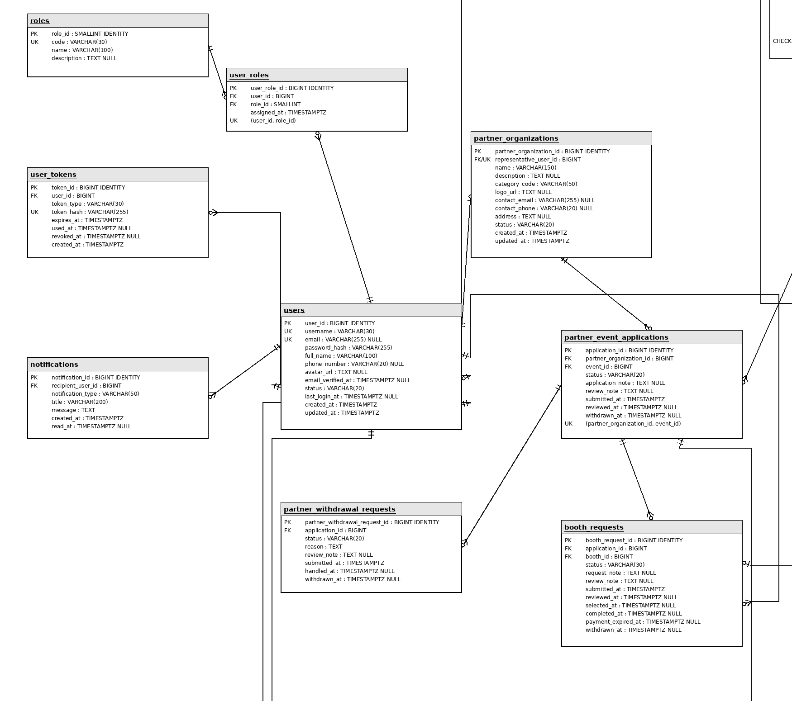
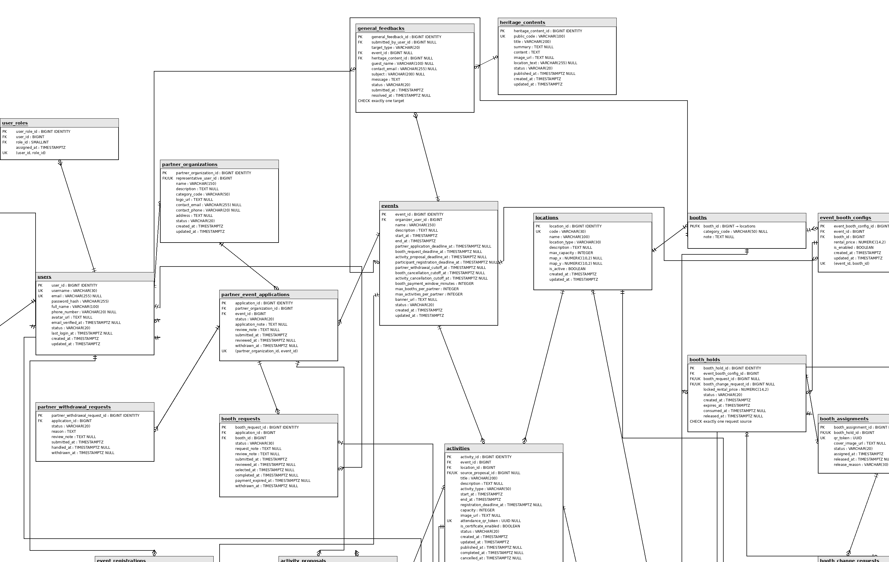
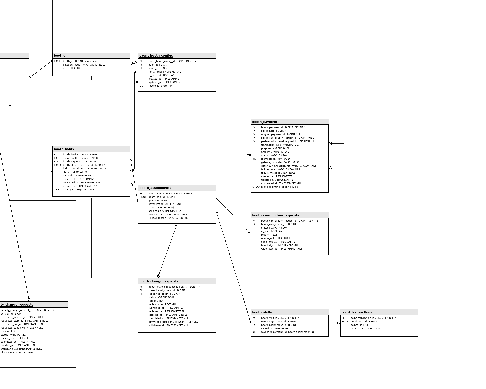

**BOOK STREET EVENT MANAGEMENT SYSTEM**

SWP391 \| Active MVP implementation updated 16 10 2026

**Mục đích tài liệu.** Tài liệu này phân biệt schema active của MVP với target Physical ERD dùng
làm tham khảo tương lai. Nguồn triển khai Physical hiện hành là các migration Flyway V1–V8; hình
33 bảng chỉ là target, không phải nguồn để tạo migration. Không được tạo table từ phần
`POST-MVP REFERENCE` nếu chưa có quyết định scope mới.

**Kết luận chính.** Target diagram có 33 bảng; active schema qua V8 hiện có 14 bảng. V8 Sprint 4
không tạo bảng mới, chỉ thêm cancellation metadata/constraint. PostgreSQL là nguồn dữ liệu chính;
Redis chỉ giữ Session. Active Booth flow là request trước Hold, initial Payment SUCCESS trước
Assignment và pre-settlement release an toàn. Refund và đổi/hủy Booth sau Assignment là Post-MVP.

# Thông tin baseline

| **Hạng mục**     | **Nội dung**                               |
|------------------|--------------------------------------------|
| Database         | PostgreSQL                                 |
| Số bảng          | 14 active qua V8; target diagram 33        |
| Quy ước tên      | snake_case, tên bảng số nhiều              |
| Khóa chính       | BIGINT GENERATED BY DEFAULT AS IDENTITY    |
| Thời gian        | TIMESTAMPTZ                                |
| Tiền             | NUMERIC(14,2) và Java BigDecimal           |
| Session          | Spring Security Session lưu trong Redis    |
| File và hình ảnh | Cloudinary hoặc S3; PostgreSQL chỉ lưu URL |

# Mục lục nội dung

- 1 Phạm vi và nguyên tắc thiết kế

- 2 Quy chuẩn Physical Database

- 3 Physical ERD tổng thể

- 4 Cụm Account và Authorization

- 5 Cụm Partner Event Location và Booth Config

- 6 Cụm Booth Allocation và Payment

- 7 Cụm Activity

- 8 Cụm Participant Attendance và Reward

- 9 Cụm Communication Feedback và Heritage

- 10 Constraint Index và Transaction quan trọng

- 11 Phân chia trách nhiệm PostgreSQL Spring Boot và Redis

- 12 Kế hoạch triển khai tiếp theo

# 1 Phạm vi và nguyên tắc thiết kế

Phần active overlay chuyển mô hình Logical MVP thành cấu trúc có thể triển khai trực tiếp trên
PostgreSQL. Target diagram còn chứa module tương lai để phục vụ thiết kế tổng thể; các entity đó
không tự động trở thành migration hiện hành. Ràng buộc đơn bảng đặt trong database; rule đọc nhiều
bảng được bảo vệ bằng Spring Boot transaction và row lock.

Thiết kế không thêm các bảng kỹ thuật không cần thiết. Không có bảng Participant riêng, Refund riêng, BoothAvailability riêng, AttendanceOperator, AttendanceSession, JWT token hoặc SystemSetting. Những khái niệm này đã được biểu diễn bằng User, status, transaction record, Redis hoặc logic dịch vụ.

## Các nguyên tắc bắt buộc

- Không hard-delete dữ liệu đã phát sinh lịch sử công khai hoặc giao dịch; dùng status như
  DISABLED, CANCELLED, RELEASED hoặc ARCHIVED. Ngoại lệ duy nhất của Sprint 4 là xóa Event còn
  `DRAFT` cùng cấu hình Event-scoped khi chưa có dependency nghiệp vụ.

- Mỗi initial-rental payment attempt là một BoothPayment riêng; không overwrite lịch sử cũ. Refund
  attempt chỉ là Post-MVP reference dù V7 đã có cột extension.

- Giá đang giao dịch được snapshot vào BoothHold và BoothPayment, không thay đổi theo cấu hình giá sau đó.

- Booth availability được suy ra từ EventBoothConfig, Active Hold và Active Assignment, không lưu thành một cột trạng thái cố định.

- Activity chỉ liên kết Location; Booth là subtype của Location và không tạo thêm quan hệ Activity với Booth.

- Activity QR và Booth QR chỉ nhận diện đối tượng được quét; User được xác định từ Session đăng nhập.

## Implemented Sprint 4 schema

V8 đã mở rộng hai bảng active:

- `events`: thêm nullable `cancelled_at`, `cancellation_reason` và CHECK để hai giá trị chỉ tồn tại
  nhất quán với status `CANCELLED`;
- `booth_requests`: thêm status `CANCELLED`, nullable `cancelled_at` và CHECK trạng thái/thời điểm.

Vì V3 đã cho phép `events.status = 'CANCELLED'` trước khi có metadata, V8 phải upgrade được dữ liệu
cũ: trước khi thêm CHECK, mọi Event `CANCELLED` thiếu metadata được backfill
`cancelled_at = updated_at` và `cancellation_reason = 'Sự kiện đã được hủy trước khi hệ thống lưu lý do.'`.
Sau backfill, Event `CANCELLED` bắt buộc có cả hai trường; status khác bắt buộc cả hai là null.
V6 chưa cho phép BoothRequest `CANCELLED`, nên không có legacy BoothRequest cần backfill.

V8 không tạo `booth_change_requests`, `booth_cancellation_requests` hoặc
`partner_withdrawal_requests`. Event cancellation release `booth_holds` hiện có; Partner release
trước settlement dùng trạng thái `WITHDRAWN`/`RELEASED` hiện có. V1–V8 là baseline migration bất
biến hiện hành.

# 2 Quy chuẩn Physical Database

| **Loại**          | **Quy chuẩn**      | **Lý do**                                                               |
|-------------------|--------------------|-------------------------------------------------------------------------|
| Tên               | snake_case         | Phù hợp PostgreSQL và dễ ánh xạ JPA.                                    |
| Primary Key       | BIGINT IDENTITY    | Đủ lớn, ổn định và dễ sử dụng trong Spring Data JPA.                    |
| Timestamp         | TIMESTAMPTZ        | Lưu thời điểm có múi giờ; backend lưu UTC và hiển thị Asia Ho Chi Minh. |
| Money             | NUMERIC(14,2)      | Tránh sai số của FLOAT hoặc DOUBLE.                                     |
| Status            | VARCHAR + CHECK    | An toàn nhưng dễ migration hơn PostgreSQL native ENUM.                  |
| QR và idempotency | UUID               | Khó đoán và phù hợp token công khai.                                    |
| Nội dung dài      | TEXT               | Dùng cho mô tả, ghi chú và nội dung Heritage.                           |
| Xóa dữ liệu       | ON DELETE RESTRICT | Giữ lịch sử nghiệp vụ và audit.                                         |

# 3 Physical ERD tổng thể

Hình tổng thể cho biết topology của 33 bảng. Do mật độ lớn, các phần sau sử dụng hình phóng to theo từng cụm để đọc datatype, PK, FK và UK rõ hơn.

*Hình 1 Physical ERD tổng thể gồm 33 bảng PostgreSQL*

# 4 Cụm Account và Authorization

Cụm Account quản lý danh tính đăng nhập và quyền truy cập. Participant có thể đăng ký bằng username và password mà không cần email. Partner, Organizer và Admin phải có email đã xác minh trước khi được cấp role tương ứng.

*Hình 2 Cụm Account Authorization và các quan hệ tới User*

| **Bảng**    | **Trách nhiệm**                                                           | **Ràng buộc chính**                                                                     |
|-------------|---------------------------------------------------------------------------|-----------------------------------------------------------------------------------------|
| users       | Lưu tài khoản, username, password hash, thông tin hiển thị và trạng thái. | Username unique không phân biệt hoa thường. Email nullable nhưng unique khi có giá trị. |
| roles       | Danh mục role hệ thống.                                                   | Code unique: PARTICIPANT, PARTNER, ORGANIZER, ADMIN.                                    |
| user_roles  | Giải quan hệ nhiều nhiều giữa User và Role.                               | PK user_role_id và UNIQUE(user_id, role_id).                                            |
| user_tokens | Token xác minh email và đặt lại mật khẩu.                                 | Chỉ lưu token_hash; có expires_at, used_at và revoked_at.                               |

confirmPassword chỉ tồn tại ở React để kiểm tra hai lần nhập mật khẩu và không được lưu trong database. Password phải được băm bằng BCrypt hoặc cơ chế tương đương của Spring Security; tuyệt đối không lưu plaintext.

# 5 Cụm Partner Event Location và Booth Config

Cụm này mô tả tổ chức Partner, việc tham gia Event, không gian vật lý và cấu hình Booth theo từng Event. Giá Booth không nằm trên bảng booths vì cùng Booth vật lý có thể có giá khác nhau giữa các Event.

*Hình 3 Cụm Partner Event Location Booth và EventBoothConfig*

| **Bảng**                   | **Trách nhiệm**                                             | **Ràng buộc chính**                                                                                |
|----------------------------|-------------------------------------------------------------|----------------------------------------------------------------------------------------------------|
| partner_organizations      | Hồ sơ tổ chức Partner và tài khoản đại diện.                | representative_user_id unique trong phạm vi MVP.                                                   |
| partner_event_applications | Đơn Partner xin tham gia một Event.                         | UNIQUE(partner_organization_id, event_id); phải APPROVED trước BoothRequest hoặc ActivityProposal. |
| events                     | Thông tin Event, deadline, cutoff, payment window và quota. | end_at lớn hơn start_at; các quota và payment window không âm.                                     |
| locations                  | Địa điểm vật lý dùng chung.                                 | Code unique; max_capacity dương; location_type phân biệt BOOTH và khu Activity.                    |
| booths                     | Subtype của Location dành cho nghiệp vụ Booth.              | booth_id vừa là PK vừa là FK tới locations.                                                        |
| event_booth_configs        | Mở một Booth trong Event với giá và cờ is_enabled.          | UNIQUE(event_id, booth_id); không disable khi có Active Hold hoặc Assignment.                      |

is_enabled chỉ có nghĩa Booth có được mở trong Event hay không. AVAILABLE, ON_HOLD và ASSIGNED là trạng thái runtime được suy ra từ Hold và Assignment; không dùng is_enabled thay cho availability.

# 6 Cụm Booth Allocation và Payment

Đây là cụm quan trọng nhất của MVP. Nhiều Partner có thể request cùng Booth. Submit request chưa khóa Booth; chỉ khi Organizer chọn candidate thì hệ thống mới tạo Hold, khóa giá và mở payment window.

*Hình 4 Target diagram; Change/Cancellation request tables là Post-MVP*

| **Bảng**                    | **Trách nhiệm**                                             | **Ràng buộc chính**                                                                      |
|-----------------------------|-------------------------------------------------------------|------------------------------------------------------------------------------------------|
| booth_requests              | Yêu cầu Booth ban đầu của Partner.                          | PENDING đến SELECTED rồi COMPLETED; candidate khác chỉ NOT_SELECTED sau payment success. |
| booth_holds                 | Giữ Booth sau khi Organizer chọn candidate và snapshot giá. | Đúng một nguồn request; tối đa một Active Hold cho EventBoothConfig.                     |
| booth_payments              | Active MVP lưu initial-rental payment attempt.              | Idempotency key unique; không overwrite retry; REFUND columns là extension Post-MVP.     |
| booth_assignments           | Cấp Booth chính thức sau settlement hợp lệ.                 | Một Hold tối đa một Assignment; qr_token unique.                                         |
| booth_change_requests       | POST-MVP REFERENCE, chưa có trong active schema.            | Không tạo trong Sprint 4.                                                                |
| booth_cancellation_requests | POST-MVP REFERENCE, chưa có trong active schema.            | Không tạo trong Sprint 4.                                                                |
| partner_withdrawal_requests | POST-MVP REFERENCE, chưa có trong active schema.            | Không tạo trong Sprint 4.                                                                |

## 6.1 Payment retry và payment window

V7 adds the approved provider/reconciliation columns to `booth_payments`:
`checkout_url`, `checkout_expires_at`, `provider_response_code`,
`provider_transaction_status`, `last_gateway_query_at`,
`trusted_incomplete_query_count`, `reconciliation_required` and
`reconciliation_detail`. The stable initial-rental purpose is
`INITIAL_BOOTH_RENTAL`. `vnp_TxnRef` is derived as `BSP{booth_payment_id}` and is therefore not
stored separately.

- A zero-price Booth creates no BoothPayment. Organizer selection creates the Hold, immediately
  consumes it and creates the Assignment atomically. A positive configured price below 5,000 VND
  is invalid.

- Mỗi retry tạo một BoothPayment mới với idempotency_key mới; attempt cũ được giữ nguyên.

- Với VNPay PAY, BoothPayment mới và toàn bộ checkout metadata (`checkout_url`,
  `checkout_expires_at`) được commit nguyên tử sau khi ký URL cục bộ. Vì không có remote
  session-creation call, hệ thống không để lại một Payment `PENDING` nhìn thấy được nhưng thiếu URL.
  Row cũ/bất thường thiếu checkout metadata sau grace period được đóng `FAILED` với
  `CHECKOUT_NOT_CREATED` để Hold đủ điều kiện có thể retry an toàn.

- FAILED hoặc TIMEOUT của một attempt không giải phóng Hold nếu expires_at chưa đến.

- Scheduled job chỉ chuyển Hold thành EXPIRED khi payment window thực sự hết hạn và không còn BoothPayment `PENDING` cần đối soát.

- Nếu `expires_at` đã qua nhưng còn Payment `PENDING`, Hold tạm giữ `ACTIVE`, request nguồn giữ `SELECTED` và Booth vẫn được suy ra là `ON_HOLD`. `expires_at` chặn mọi payment attempt mới; nó không cho phép release/reassign khi kết quả giao dịch cũ chưa rõ.

- Qua V7, reconciliation claim lượt QueryDR trong một transaction ngắn bằng lock `Hold → Payment`
  và ghi `last_gateway_query_at`, sau đó mới nhả lock và gọi gateway ngoài DB transaction. Khi triển
  khai Sprint 4, mỗi transaction ngắn này phải khóa Event trước rồi giữ thứ tự `Hold → Payment` bên
  trong; gateway I/O vẫn nằm ngoài transaction. Cơ chế claim chặn nhiều worker gọi trùng trong
  minimum query interval. SUCCESS consume Hold và tạo Assignment; FAILED hoặc TIMEOUT expire Hold
  nếu `expires_at` đã qua; kết quả chưa rõ giữ nguyên Hold và Payment để không cấp Booth trùng.

- Mọi truy vấn availability và selection phải coi một row Hold `ACTIVE` là đang khóa Booth kể cả khi `expires_at` đã qua. Chỉ expiry/reconciliation service mới được chuyển row đó sang `EXPIRED`; partial unique index hiện có tiếp tục là lớp bảo vệ cuối cùng.

- Payment SUCCESS được backend xác minh trước khi tạo BoothAssignment.

## 6.2 Refund bất đồng bộ — POST-MVP REFERENCE

Khi Organizer duyệt cancellation hoặc withdrawal đủ điều kiện, database tạo BoothPayment REFUND với trạng thái PENDING và hoàn tất thay đổi nghiệp vụ. Hệ thống không giữ Assignment hoặc Change Request ở trạng thái chờ chỉ vì ngân hàng chưa xử lý refund.

*Hình 5 Nguồn nghiệp vụ của refund transaction*

Nếu refund attempt thất bại, lần retry tạo record mới. Trước khi retry, Spring Boot khóa Payment gốc và kiểm tra tổng refund PENDING cộng SUCCESS không vượt số tiền được hoàn.

## 6.3 Đổi Booth — POST-MVP REFERENCE

| **So sánh giá**  | **Điều kiện swap**                    | **Kết quả**                                       |
|------------------|---------------------------------------|---------------------------------------------------|
| Giá mới cao hơn  | Payment phần chênh lệch phải SUCCESS. | Assignment cũ REPLACED; Assignment mới ACTIVE.    |
| Giá bằng nhau    | Không cần transaction tiền.           | Atomic swap ngay sau khi duyệt và kiểm tra Booth. |
| Giá mới thấp hơn | Tạo REFUND PENDING thành công.        | Swap không chờ ngân hàng hoàn tiền.               |

# 7 Cụm Activity

Activity không có payment. Proposal chỉ là đề xuất và chưa khóa Location. Khi Proposal được duyệt hoặc Organizer tạo Activity trực tiếp, Activity chính thức mới tham gia kiểm tra xung đột thời gian và địa điểm.

*Hình 6 Cụm Activity Proposal Activity Change và Cancellation*

| **Bảng**                       | **Trách nhiệm**                              | **Ràng buộc chính**                                                                              |
|--------------------------------|----------------------------------------------|--------------------------------------------------------------------------------------------------|
| activity_proposals             | Đề xuất Activity của Partner.                | Application phải APPROVED; proposed_end_at sau proposed_start_at; capacity dương.                |
| activities                     | Activity chính thức thuộc Event và Location. | Một source proposal tối đa một Activity; QR nằm trên Activity; chặn trùng Location và thời gian. |
| activity_change_requests       | Xin đổi Location, thời gian hoặc capacity.   | Phải có ít nhất một requested value; chỉ một request PENDING trên Activity.                      |
| activity_cancellation_requests | Xin hủy Activity đã duyệt hoặc publish.      | is_late xét activityCancellationCutoffAt; Activity không tạo refund.                             |

PostgreSQL nên dùng exclusion constraint trên location_id và tstzrange(start_at, end_at) để ngăn hai Activity chính thức trùng thời gian tại cùng Location, kể cả chúng thuộc hai Event khác nhau.

# 8 Cụm Participant Attendance và Reward

Participant không phải bảng riêng. Một User trở thành Participant của Event thông qua EventRegistration. Từ đó User đăng ký Activity, tự quét Activity QR để tạo Attendance hoặc tự quét Booth QR để tạo BoothVisit.

*Hình 7 Cụm Event Registration Activity Registration và Attendance*

| **Bảng**               | **Trách nhiệm**                             | **Ràng buộc chính**                                                                          |
|------------------------|---------------------------------------------|----------------------------------------------------------------------------------------------|
| event_registrations    | Ghi nhận User tham gia Event.               | UNIQUE(user_id, event_id); có thể tự tạo khi User đăng ký Activity.                          |
| activity_registrations | Ghi nhận Participant đăng ký Activity.      | UNIQUE(event_registration_id, activity_id); transaction khóa Activity khi kiểm tra capacity. |
| attendances            | Bằng chứng Participant đã tham dự Activity. | Một ActivityRegistration tối đa một Attendance; scan lặp không tạo record mới.               |
| activity_ratings       | Đánh giá Activity của người đã tham dự.     | Một Attendance tối đa một rating; score từ 1 đến 5.                                          |
| certificates           | Chứng nhận sau khi Activity hoàn tất.       | Một Attendance tối đa một Certificate; snapshot tên người nhận khi cấp.                      |

## 8.1 Booth Visit Points và Badge

*Hình 8 Quan hệ EventRegistration BoothVisit BoothAssignment và PointTransaction*

*Hình 9 Cụm Reward gồm PointTransaction Badge UserBadge và Certificate*

| **Bảng**           | **Trách nhiệm**                         | **Ràng buộc chính**                                   |
|--------------------|-----------------------------------------|-------------------------------------------------------|
| booth_visits       | Ghi nhận User ghé một Booth Assignment. | UNIQUE(event_registration_id, booth_assignment_id).   |
| point_transactions | Lưu điểm sinh ra từ BoothVisit.         | Một BoothVisit tối đa một transaction; points dương.  |
| badges             | Danh mục Badge và ngưỡng điểm.          | Tên unique; required_points dương; có thể inactive.   |
| user_badges        | Badge User đã đạt.                      | UNIQUE(user_id, badge_id); không cấp trùng khi retry. |

Tổng điểm được tính bằng SUM(point_transactions.points), không lưu thêm total_points trong users. Cách này giữ được lịch sử và tránh lệch giữa số dư với transaction.

# 9 Cụm Communication Feedback và Heritage

*Hình 10 Cụm Notification GeneralFeedback và HeritageContent*

| **Bảng**          | **Trách nhiệm**                    | **Ràng buộc chính**                                                |
|-------------------|------------------------------------|--------------------------------------------------------------------|
| notifications     | Thông báo trong website cho User.  | read_at null nghĩa UNREAD; User không có email vẫn nhận thông báo. |
| general_feedbacks | Phản hồi public hoặc từ User.      | Đúng một target: BOOK_STREET, EVENT hoặc HERITAGE.                 |
| heritage_contents | Nội dung di sản công khai lâu dài. | public_code unique; chỉ PUBLISHED mới hiển thị public.             |

ActivityRating tách khỏi GeneralFeedback. ActivityRating bắt buộc có Attendance; GeneralFeedback có thể được Guest gửi và không target Activity.

# 10 Constraint Index và Transaction quan trọng

## 10.1 Unique và partial unique

| **Phạm vi**  | **Constraint**                                                                                                   |
|--------------|------------------------------------------------------------------------------------------------------------------|
| Identity     | LOWER(users.username) unique; LOWER(users.email) unique khi email không null.                                    |
| Event Booth  | UNIQUE(event_id, booth_id) trên event_booth_configs.                                                             |
| Hold         | Partial UNIQUE(event_booth_config_id) WHERE status = ACTIVE.                                                     |
| Payment      | UNIQUE(idempotency_key) và unique gateway provider cộng transaction reference khi reference có giá trị.          |
| Registration | Unique user Event; unique EventRegistration Activity; unique Attendance trên ActivityRegistration.               |
| Reward       | Unique PointTransaction trên BoothVisit; unique UserBadge; unique Certificate và ActivityRating trên Attendance. |
| Feedback     | CHECK XOR bảo đảm đúng một target.                                                                               |

## 10.2 Các transaction bắt buộc

| **Nghiệp vụ**            | **Row cần khóa**                      | **Kết quả atomic**                                                                                   |
|--------------------------|---------------------------------------|------------------------------------------------------------------------------------------------------|
| Organizer chọn Booth     | Event, Booth rồi EventBoothConfig      | Kiểm tra status, enabled, Hold và Assignment rồi tạo Hold cùng cập nhật Request.                      |
| Payment callback SUCCESS | Event rồi BoothHold rồi BoothPayment  | Với Event PUBLISHED/ONGOING: Payment SUCCESS, Hold CONSUMED, Assignment ACTIVE, Request COMPLETED và candidate khác NOT_SELECTED. |
| Payment window hết hạn   | Event rồi BoothHold                   | Hold EXPIRED và request nguồn PAYMENT_EXPIRED; candidate khác giữ PENDING.                           |
| Partner release trước settlement | Event rồi BoothHold rồi BoothPayment | Khi không có evidence chặn: request WITHDRAWN và Hold RELEASED; candidate khác giữ PENDING. |
| Organizer hủy Event      | Event rồi các Hold/Payment/Request theo id | Event/request CANCELLED và Hold RELEASED hoặc toàn bộ transaction rollback.                      |
| Đăng ký Activity         | Activity                              | Kiểm tra deadline và capacity rồi insert Registration; không overbook.                               |
| Quét Booth QR            | EventRegistration và Assignment       | Tạo BoothVisit, PointTransaction và UserBadge trong cùng transaction.                                |

Mọi transaction state-changing thuộc một Event phải khóa Event trước. Các hàng còn lại của cụm
Booth/Payment tuân theo `Event → Booth (nếu cần) → EventBoothConfig (nếu cần) → BoothHold →
BoothPayment theo id tăng dần → BoothRequest`; bảng trên chỉ liệt kê các row nghiệp vụ đặc thù,
không thay thế thứ tự khóa toàn cục này.

`BoothHold.expiresAt` là giới hạn checkout theo lịch, không phải tín hiệu được phép xóa evidence
chưa chắc chắn. Payment còn `PENDING` hoặc cần reconciliation có thể giữ Hold `ACTIVE` khi Event đã
`ONGOING`. Trusted success chỉ tạo Assignment tự động khi Event còn `PUBLISHED` hoặc `ONGOING`;
nếu Event đã `COMPLETED` hoặc `CANCELLED`, evidence được giữ để xử lý thủ công và không tạo
Assignment.

## 10.3 Index cần ưu tiên

- Index tất cả Foreign Key thường dùng để join hoặc filter.

- booth_requests(booth_id, status) để Organizer xem candidate của Booth.

- booth_holds(event_booth_config_id, status) và booth_holds(expires_at) để kiểm tra availability và job hết hạn.

- booth_payments(booth_hold_id, status) và gateway transaction reference để xử lý callback.

- activities(event_id, status) và activity_registrations(activity_id, status) cho lịch và capacity.

- notifications(recipient_user_id, created_at) với partial index read_at IS NULL.

# 11 Phân chia trách nhiệm PostgreSQL Spring Boot và Redis

| **Lớp**     | **Chịu trách nhiệm**                                                             | **Không nên chịu trách nhiệm**                                                      |
|-------------|----------------------------------------------------------------------------------|-------------------------------------------------------------------------------------|
| PostgreSQL  | Dữ liệu bền vững, FK, UNIQUE, CHECK, lịch sử transaction.                        | Session tạm thời hoặc file ảnh nhị phân.                                            |
| Spring Boot | State transition, cross-table rule, transaction, row lock, gateway verification. | Bỏ qua constraint database hoặc tự tin vào dữ liệu từ frontend.                     |
| Redis       | Spring Session và có thể rate limiting.                                          | Booth availability, payment status, activity capacity hoặc point balance trong MVP. |
| React       | Hiển thị form, validation cơ bản và gọi REST API.                                | Quyết định quyền, giá hoặc trạng thái nghiệp vụ cuối cùng.                          |
| Gateway     | Xử lý initial Booth payment và gửi callback.                                     | Tự tạo Assignment; backend phải xác minh callback.                                  |

# 12 Kế hoạch triển khai tiếp theo

Sau khi Physical ERD được duyệt, team nên triển khai theo thứ tự dưới đây để giảm việc sửa chéo giữa các module.

1.  Khóa Physical ERD và viết PostgreSQL DDL đầy đủ gồm table, FK, CHECK, unique index và partial index.

2.  Tạo migration bằng Flyway trong Spring Boot; không dùng Hibernate ddl auto update cho môi trường chung.

3.  Tạo JPA Entity và Repository theo từng cụm, bắt đầu từ Account, Partner, Event, Location và Booth Config.

4.  Cài Spring Security Session; giai đoạn local có thể dùng memory session, sau đó chuyển sang Redis mà không đổi bảng PostgreSQL.

5.  Xây Booth flow end to end: Application, Request, Selection, Hold, Payment callback, Assignment và expiration job.

6.  Xây Activity flow: Proposal, approval, conflict check, Registration và self scan Attendance.

7.  Xây Booth Visit, Points, Badge, Certificate, Rating, Notification và Feedback sau khi luồng cốt lõi ổn định.

8.  Tạo seed data cho một Event, nhiều Partner cạnh tranh cùng Booth, một payment retry thành công và một payment window hết hạn.

9.  Viết integration test cho transaction và concurrency, đặc biệt Hold, Payment callback, capacity và QR scan lặp.

10. Cập nhật Demo Workflow và tài liệu API theo đúng status và constraint của Physical baseline.

## Checklist trước khi bắt đầu code

| **Kiểm tra** | **Kết quả mong đợi**                                                                         |
|--------------|----------------------------------------------------------------------------------------------|
| Naming       | Tên bảng và cột giống Physical ERD; không tự đặt tên khác trong từng module.                 |
| Status       | Mỗi status có state transition rõ và được dùng thống nhất giữa backend frontend và database. |
| Time         | Backend dùng Instant hoặc OffsetDateTime; hiển thị theo Asia Ho Chi Minh.                    |
| Money        | Java dùng BigDecimal; không dùng double.                                                     |
| Transactions | Các luồng selection payment swap capacity và QR được đánh dấu transactional.                 |
| Idempotency  | Payment callback và QR scan lặp trả kết quả cũ, không tạo dữ liệu trùng.                     |
| Security     | Password và token chỉ lưu hash; cookie Session dùng HttpOnly Secure và có CSRF protection.   |
| Testing      | Có test happy path, retry, timeout, duplicate callback và thao tác đồng thời.                |

# 13 Kết luận

Active schema qua V7 gồm 14 bảng và Sprint 4 chỉ bổ sung V8 theo overlay đã chốt. Target ERD 33
bảng vẫn hữu ích cho định hướng Activity, Attendance, Reward và các extension Post-MVP, nhưng không
phải giấy phép tạo Booth change/cancellation/withdrawal hoặc refund workflow. Khi triển khai, team
xem PostgreSQL là source of truth, Redis chỉ giữ Session và mọi thay đổi schema phải đi qua Flyway.
